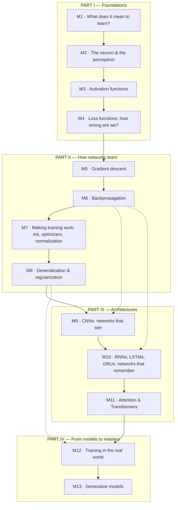

# Neural Networks — From Zero to Advanced

> [!abstract] What this course is
> This is a complete, self-contained course on **neural networks**: what they are, why they work, how they learn, and how the modern architectures (CNNs, RNNs, Transformers) are built from the same few ideas. It is for a student starting at **absolute zero** — no calculus fluency assumed, no prior ML assumed.
> By the end you will be able to: read a neural-network paper or codebase and understand it; derive backpropagation by hand; train a small network from scratch in NumPy; explain *why* each design choice exists (not just what it is); and debug training when it goes wrong.
> **The one rule of this course:** nothing here is "just how it is". Every rule has a reason. If a reason is ever missing, that is a defect in the course, not in you.

## How to use this course

**Study loop (do this, don't just read):**
1. **Predict** — before reading a section's explanation, guess the answer. Your brain learns from wrong guesses, not from nodding along.
2. **Type or derive** — retype every code example yourself; re-derive every boxed derivation on paper. Reading a derivation is worth ~10% of doing it.
3. **Check** — run the code. Compare your derivation with the one here.
4. **Fix** — when you disagree with the course, figure out exactly where. That disagreement *is* the learning.

**Setup:** you need Python 3 with NumPy (`pip install numpy`). Every program in this course is complete and runnable, and every one was actually executed — the outputs shown are real. No GPUs, no frameworks needed until Part IV (and even there, everything important is first built in NumPy so you see the machinery).

**Notation used throughout:** scalars in *italics* ($w$), vectors in **bold** ($\mathbf{x}$), matrices in capitals ($W$). $\odot$ means element-wise multiplication. $\sigma$ means the sigmoid function unless stated otherwise.

## Course map



*Read the map like a dependency graph: every module exists because the next one needs it. M9 and M10 both build directly on backprop (M6); M12 applies the regularization ideas of M8.*

---

# PART I — THINKING MACHINES: FOUNDATIONS

# Module 1 — What does it mean to "learn" from data?

**What problem this module solves:** before any math, we need to agree on what "learning" even means for a machine. Everything in this course is an answer to one question: *how do we get a computer to improve at a task from examples, instead of from hand-written rules?* Without this framing, neural networks look like magic tricks. With it, every later module is just engineering.

## 1.1 Learning = finding a function that fits examples

> [!kid] Learning, like learning to catch a ball
> Imagine teaching a little kid to catch a ball. You don't give them physics equations about parabolas. You throw the ball, they miss, you throw again, they adjust. After 100 throws, their brain has tuned itself. Nobody wrote "move hand 3 cm left" as a rule — the *examples* did the teaching.
>
> A neural network learns exactly like that. You show it thousands of examples ("this picture is a cat", "this picture is not a cat"), it guesses, it measures how wrong it was, and it adjusts. The "rules" it ends up with were never written by a human.

**Definition.** **Machine learning** is the construction of programs whose behaviour improves with experience. Formally: a program *learns* from experience $E$ on task $T$ with performance measure $P$ if its performance on $T$, measured by $P$, improves with $E$.

In practice, almost all of it reduces to **function fitting**: we want a function $f$ such that $f(\text{input}) \approx \text{correct output}$, and we find $f$ by searching through a family of candidate functions using data.

> [!why] Why fit functions instead of writing rules?
> For decades, AI meant hand-written rules ("if the pixel pattern looks like *this*, it's a cat"). This works for chess and taxes, but fails for perception: try writing a rule that recognises a cat in *every* photo. The number of edge cases is effectively infinite, and humans can't even articulate how *they* recognise cats. Data contains the answers implicitly; learning algorithms extract them. The shift from "program the solution" to "program the *learner*" is the entire reason neural networks matter.

## 1.2 The three ingredients of every learning system

Every module in this course manipulates three things:

| Ingredient | Plain meaning | Example (cat classifier) |
|---|---|---|
| **Model** | The family of functions we search through | "All functions a 3-layer network can express" |
| **Loss** | A number measuring how wrong the current function is | "Fraction of training cats misclassified" (refined in M4) |
| **Optimizer** | The procedure that nudges the function toward lower loss | Gradient descent (M5) |

> [!tip] The three-ingredient lens
> Whenever you meet a new architecture or paper, ask: *what is the model, what is the loss, what is the optimizer?* If you can answer those three, you understand the paper. This course is organised so that Part I builds the model and loss, Part II builds the optimizer, and Part III combines them into architectures.

## 1.3 Supervised, unsupervised, and the rest

**Definitions.**
- **Supervised learning:** each training example comes with the right answer (a **label**). Task: predict labels for new inputs. (Cat vs. not-cat; house price from features.)
- **Unsupervised learning:** examples have no labels. Task: find structure. (Grouping customers; compressing data.)
- **Reinforcement learning:** no correct answers, only rewards for actions. Task: learn a behaviour policy. (Game playing.)

This course is 95% supervised learning, because that is where neural networks are best understood and where the core ideas (loss, gradients, backprop) live. M13 touches unsupervised/generative ideas.

> [!question] Try it
> Your email spam filter improves as you mark emails "spam" / "not spam". Which kind of learning is this, and what are the model, loss, and optimizer likely to be?
> <details><summary>Solution</summary>Supervised learning (every email you mark is a labelled example). Model: some classifier function. Loss: how often it disagrees with your labels. Optimizer: whatever update rule retrains it on your corrections — conceptually gradient descent (M5).</details>

---

# Module 2 — The neuron and the perceptron

**What problem this module solves:** M1 said "search through a family of functions" — but *which* family? This module builds the smallest possible learnable unit, the **perceptron**, and discovers its fatal flaw. That flaw is the reason hidden layers, activation functions, and eventually this entire course exist.

## 2.1 The biological cartoon (and an honest disclaimer)

> [!kid] A neuron is a tiny voter
> Imagine a neuron as a person in a meeting voting YES or NO. Each person whispering to them has a different level of persuasiveness — some whispers count double, some count as negative ("whatever *he* says, do the opposite"). The neuron adds up all the weighted whispers, and if the total passes a threshold, it shouts YES.

**Definition.** An **artificial neuron** computes a **weighted sum** of its inputs plus a **bias**, then applies a nonlinearity:

$$z = \mathbf{w} \cdot \mathbf{x} + b = \sum_{i=1}^{n} w_i x_i + b, \qquad a = \phi(z)$$

- $\mathbf{x}$: the **input vector** (the whispers).
- $\mathbf{w}$: the **weight vector** — how much each input counts. These are *learned*.
- $b$: the **bias** — a learned threshold shift. (Equivalently, a weight on a constant input of 1.)
- $\phi$: the **activation function** (M3). For the perceptron, $\phi$ is a step: output 1 if $z \ge 0$, else 0.

> [!warning] The brain analogy is loose — on purpose
> Real neurons spike in time, rewire themselves, and do things no equation here captures. Artificial neurons borrow only the barest idea: *many weak inputs, weighted, summed, thresholded*. Treat "neural" as a historical name, not a biological claim. The math stands on its own.

## 2.2 The perceptron learning rule

**Definition.** The **perceptron** (Rosenblatt, 1957) is a single neuron with step activation, trained by this rule: for each example $(\mathbf{x}, y)$,

1. Predict $\hat{y} = 1$ if $\mathbf{w}\cdot\mathbf{x} + b \ge 0$, else $0$.
2. If wrong, nudge: $\mathbf{w} \leftarrow \mathbf{w} + \eta\,(y - \hat{y})\,\mathbf{x}$, $\quad b \leftarrow b + \eta\,(y - \hat{y})$

where $\eta > 0$ is the **learning rate** (step size).

> [!why] Why this update makes sense
> Look at the three cases. If $y = 1$ but $\hat{y} = 0$, then $(y-\hat{y}) = +1$ and we add $\eta\mathbf{x}$ to $\mathbf{w}$ — the weights rotate *toward* the input, making $z$ bigger next time, pushing it over the threshold. If $y = 0$ but $\hat{y} = 1$, we subtract — rotating *away*. If correct, $(y - \hat{y}) = 0$ and nothing changes. It is error-correction, not magic. (M5 will reveal this as gradient descent in disguise.)

**Theorem (perceptron convergence, sketch).** If the data is **linearly separable** — i.e., some straight line/plane separates the classes — the perceptron rule finds such a separator in a finite number of updates. *Proof idea:* each mistake increases the alignment of $\mathbf{w}$ with *some* perfect separator while $\lVert\mathbf{w}\rVert$ grows only slowly; the angle between them must shrink to zero, so mistakes can't go on forever. The full proof needs only the Cauchy–Schwarz inequality.

> [!example] Worked: the perceptron learns AND
> The AND gate: output 1 only for input $(1,1)$. This is linearly separable (draw the four points; one line separates $(1,1)$ from the rest). Let's watch the rule work, for real — the program below is complete and was actually run:

```python
import numpy as np

X = np.array([[0, 0], [0, 1], [1, 0], [1, 1]])
y = np.array([0, 0, 0, 1])  # AND gate

w = np.zeros(2)
b = 0.0
lr = 0.5

for epoch in range(20):
    errors = 0
    for xi, target in zip(X, y):
        pred = 1 if (w @ xi + b) >= 0 else 0
        update = lr * (target - pred)
        w = w + update * xi   # perceptron update rule
        b = b + update
        errors += abs(target - pred)
    if errors == 0:
        print(f"converged at epoch {epoch}")
        break

print("w =", w, " b =", b)
for xi, target in zip(X, y):
    pred = 1 if (w @ xi + b) >= 0 else 0
    print(f"{xi} -> {pred} (target {target})")
```

Expected output (exactly what the run produced):

```
converged at epoch 5
w = [1.  0.5]  b = -1.5
[0 0] -> 0 (target 0)
[0 1] -> 0 (target 0)
[1 0] -> 0 (target 0)
[1 1] -> 1 (target 1)
```

*Reading the result:* the learned separator is $x_1 + 0.5x_2 - 1.5 \ge 0$. Check $(1,1)$: $1 + 0.5 - 1.5 = 0 \ge 0$ → 1 ✓. Check $(0,1)$: $-1 < 0$ → 0 ✓. Five passes over four examples — that is all "learning" was here.

## 2.3 The flaw that launched a field: XOR

> [!kid] The problem with drawing only straight lines
> Imagine sorting red and blue marbles on a table, but you're only allowed to separate them with ONE straight stick. If all reds are on one side, easy. But what if the reds are in two opposite corners and blues in the other two? No single straight stick can do it. That's XOR — and one perceptron is exactly "one straight stick".

**Definition.** **XOR** (exclusive or): output 1 when the inputs *differ*: $(0,1)\to1$, $(1,0)\to1$, $(0,0)\to0$, $(1,1)\to0$.

**Claim.** No single perceptron can learn XOR. *Proof:* a perceptron decides by $\mathbf{w}\cdot\mathbf{x}+b \ge 0$, a straight line. The four XOR points form the corners of a square with opposite corners sharing a label. Any straight line leaves at least one corner on the wrong side — check all cases: a line separating $(0,1)$ and $(1,0)$ (label 1) from $(0,0)$ and $(1,1)$ (label 0) would need to put opposite corners on the same side, impossible for a straight cut. ∎

> [!why] Why this matters so much
> Minsky and Papert proved this limitation in 1969, and it froze neural-network research for years: if one neuron can only draw straight lines, what use is it? The answer — which took the field a decade to make practical — is **layers**: stack neurons so later layers work with the *bent* output of earlier ones. Two layers can solve XOR easily. But stacking creates a new problem: *how do you assign blame to the hidden layers when the output is wrong?* That problem is called **credit assignment**, and its solution is backpropagation (M6). The whole rest of Part II exists because of XOR.

> [!question] Try it
> Is the OR gate linearly separable? What about "output 1 if $x_1 = x_2$" (equivalence/XNOR)?
> <details><summary>Solution</summary>OR is separable: e.g. $w = [1,1]$, $b = -0.5$ gives $x_1 + x_2 \ge 0.5$, true for $(0,1),(1,0),(1,1)$ only. XNOR ("same → 1") is just XOR flipped — same square, opposite labels — also not separable by one line. Any function whose "1" points are opposite corners of a square defeats a single perceptron.</details>

**Where we stand:** we have a learnable unit (perceptron) and we know one layer isn't enough. Next: the two ingredients that make stacking work — nonlinear activations (M3) and a way to measure wrongness (M4).

## 2.4 What "deep" means

**Definition.** A **feedforward neural network** (multilayer perceptron, **MLP**) stacks neurons in **layers**: the outputs (**activations**) of one layer are the inputs of the next. Information flows one way — input → hidden layers → output — with no loops. (**Hidden layers** are "hidden" only because they are neither input nor output; nothing mysterious.)

A network with $L$ layers computes:

$$\mathbf{a}^{(0)} = \mathbf{x}, \qquad \mathbf{z}^{(l)} = W^{(l)}\mathbf{a}^{(l-1)} + \mathbf{b}^{(l)}, \qquad \mathbf{a}^{(l)} = \phi(\mathbf{z}^{(l)})$$

**"Deep"** just means *many layers*. Depth is what buys expressive power: each layer re-represents the data in a more useful form. (There is a theorem about this — the universal approximation theorem — stated honestly in §3.4.)

---

# Module 3 — Activation functions: the bend in the line

**What problem this module solves:** M2 showed one layer draws straight lines. Stacking *linear* layers is pointless — a stack of linear functions is still one linear function ($W_2(W_1\mathbf{x}) = (W_2W_1)\mathbf{x}$). The **activation function** $\phi$ is the nonlinearity that makes depth meaningful. Choose it badly and networks can't learn at all.

## 3.1 Why nonlinearity is non-negotiable

> [!kid] Bending instead of only straight cuts
> A straight stick couldn't separate the XOR marbles. But what if you're allowed to *bend* the table first — fold it so the two red corners land on the same side — and *then* lay down your straight stick? That's what a hidden layer with a nonlinear activation does: it bends the space so the next layer's straight cut works.

**Claim.** A stack of purely linear layers collapses to a single linear layer, no matter how deep. *Proof:* $\mathbf{a}^{(l)} = W^{(l)}\mathbf{a}^{(l-1)} + \mathbf{b}^{(l)}$ with no $\phi$ gives $\mathbf{a}^{(L)} = W'\mathbf{x} + \mathbf{b}'$ where $W' = W^{(L)}\cdots W^{(1)}$ — just matrix multiplication associativity. Depth without nonlinearity adds zero power. ∎

## 3.2 The zoo: sigmoid, tanh, ReLU, and friends

> [!kid] Four kinds of squish
> - **Sigmoid** is like a cautious friend: any input gets squeezed into an answer between 0 and 1 — "how sure am I, as a percentage?"
> - **Tanh** is the same friend but allowed to say negative things: squeezes into −1 to 1.
> - **ReLU** is a bouncer with a simple rule: "negatives don't get in" — it passes positive numbers through unchanged and turns everything negative into 0.
> - **Softmax** is for multiple-choice: it takes a list of scores and turns them into probabilities that add up to 1.

**Definitions and derivatives** (you will need every derivative in M6, so learn them here):

| Function | Formula $\phi(z)$ | Derivative $\phi'(z)$ | Range |
|---|---|---|---|
| **Sigmoid** | $\dfrac{1}{1+e^{-z}}$ | $\phi(1-\phi)$ | $(0,1)$ |
| **Tanh** | $\dfrac{e^{z}-e^{-z}}{e^{z}+e^{-z}}$ | $1-\phi^2$ | $(-1,1)$ |
| **ReLU** | $\max(0, z)$ | $1$ if $z>0$ else $0$ | $[0,\infty)$ |
| **Leaky ReLU** | $\max(\alpha z, z)$, $\alpha\approx0.01$ | $1$ if $z>0$ else $\alpha$ | $(-\infty,\infty)$ |
| **Softmax** (vector in, vector out) | $\dfrac{e^{z_i}}{\sum_j e^{z_j}}$ | (Jacobian — see §4.4) | prob. simplex |

**Derivation — sigmoid derivative** (the pattern recurs constantly): with $\sigma = (1+e^{-z})^{-1}$,

$$\frac{d\sigma}{dz} = -(1+e^{-z})^{-2}\cdot(-e^{-z}) = \frac{e^{-z}}{(1+e^{-z})^2} = \frac{1}{1+e^{-z}}\cdot\frac{e^{-z}}{1+e^{-z}} = \sigma(1-\sigma)$$

using $\frac{e^{-z}}{1+e^{-z}} = 1 - \sigma$. Note the beautiful consequence: once you know the *output* $\sigma$, you know the derivative — no need to remember $z$. Backprop exploits this everywhere.

> [!why] Why ReLU took over the world
> Sigmoid and tanh **saturate**: for large $|z|$, the curve goes flat, so $\phi'(z) \approx 0$. During training, gradients get multiplied by these derivatives (M6) — flat regions mean the signal dies and learning stalls (**vanishing gradients**). ReLU's derivative is exactly 1 for all positive inputs: no saturation, no shrink, and it's dirt cheap to compute. The cost: the **dying ReLU** problem (below). Tanh is still preferred in recurrent nets (M10) because its outputs are zero-centred, which keeps gradients better behaved there.

> [!warning] Traps with activations
> - **Dying ReLU:** if a neuron's weights push it so $z < 0$ for *all* training examples, its gradient is exactly 0 forever — it can never recover. Leaky ReLU ($\alpha z$ for negatives) gives a small gradient and avoids this.
> - **Sigmoid in hidden layers of deep nets:** saturates → vanishing gradients. Use it at the *output* for binary probabilities, not deep inside.
> - **ReLU is not differentiable at 0:** in practice we just define the subgradient as 0 (or 1); it never matters numerically.
> - **Softmax inputs must be raw scores (logits), not probabilities.** Applying softmax twice is a real bug people write.

> [!tip] Default choices that are right 90% of the time
> Hidden layers: **ReLU** (or Leaky ReLU / GELU in transformers). Binary output: **sigmoid**. Multi-class output: **softmax**. Regression output: **no activation** (raw linear). If training stalls, the activation is a prime suspect.

> [!question] Try it
> Why is tanh's output being "zero-centred" (mean ≈ 0) helpful, compared to sigmoid's outputs (mean ≈ 0.5)?
> <details><summary>Solution</summary>Gradients for a weight are proportional to the activation flowing through it. If activations are always positive (sigmoid), all gradients for a neuron's incoming weights share the same sign in each step — updates zigzag instead of heading straight toward the minimum, slowing convergence. Zero-centred activations let updates point in any direction. (Same logic motivates input normalization and BatchNorm in M7.)</details>

## 3.3 Softmax: why exponentiate?

**Definition.** For raw scores (logits) $\mathbf{z} = (z_1, \dots, z_K)$, $\text{softmax}(\mathbf{z})_i = e^{z_i}/\sum_j e^{z_j}$.

> [!why] Why $e^{z}$ and not something simpler?
> Three reasons, each load-bearing: (1) **positivity** — probabilities can't be negative, and $e^z > 0$ always; (2) **normalization** — dividing by the sum makes them add to 1; (3) **amplification of differences** — exponentiation exaggerates gaps, so the biggest logit dominates, giving confident, decisive probabilities while staying differentiable (unlike a hard "pick the max"). Softmax is the smooth, differentiable cousin of argmax.

> [!tip] Numerical stability
> $e^{1000}$ overflows. Use the identity $\text{softmax}(\mathbf{z}) = \text{softmax}(\mathbf{z} - c)$ for any constant $c$ (the $e^{-c}$ factors cancel top and bottom — verify it yourself), with $c = \max_i z_i$. Every real implementation does this; forgetting it gives NaNs.

## 3.4 An honest word on universal approximation

**Theorem (universal approximation, Cybenko 1989 — statement only).** A feedforward network with one hidden layer and a nonlinear activation can approximate *any* continuous function on a compact set, arbitrarily well, given *enough* hidden neurons.

> [!warning] What the theorem does NOT promise
> It says a good network *exists* — not that gradient descent will *find* it, not how many neurons "enough" is (often astronomically many), and not that it will generalise to new data. It justifies using neural nets as a function family (M1's "model" ingredient) but explains nothing about learning. Depth (many layers) turns out to be far more parameter-efficient than width for real tasks — but *why* depth helps so much is still partly an open question. The course admits this openly: we know it works, the full theory is unfinished.

---

# Module 4 — Loss functions: measuring wrongness

**What problem this module solves:** M1's second ingredient. "Adjust when wrong" (M2) needs a number for *how* wrong — and not just any number. The loss must be **differentiable** (so we can follow its slope downhill in M5) and must **mean something** (so "low loss" actually means "good model"). This module derives the three losses you'll use for years.

## 4.1 Regression: mean squared error

> [!kid] How wrong, in ruler units
> If the network guesses a house costs \$300k and it's really \$320k, it's off by \$20k. Square that (so overshooting and undershooting both count, and big mistakes count *a lot* more than small ones), average over all houses — that's the loss. Zero means perfect.

**Definition.** For predictions $\hat{y}_i$ and targets $y_i$: $\mathcal{L}_{\text{MSE}} = \frac{1}{n}\sum_{i=1}^{n}(y_i - \hat{y}_i)^2$.

> [!why] Why square instead of absolute value?
> (1) Squaring penalises large errors disproportionately — usually what we want (being off by 10 twice is better than off by 20 once, in most applications). (2) It is smooth and differentiable everywhere, unlike $|y-\hat{y}|$ which has a kink at zero. (3) Deep reason: minimising MSE is equivalent to **maximum likelihood** under Gaussian noise — i.e., if you assume errors are bell-curved noise, MSE is the statistically principled choice. Mean absolute error (MAE) corresponds to Laplacian noise and is more robust to outliers; the choice encodes an assumption about your noise.

## 4.2 Classification: cross-entropy

> [!kid] Punishing confident wrongness
> If the network says "99% sure it's a cat" and it's actually a dog, that's much worse than saying "51% sure". Cross-entropy is a scoring rule with exactly that property: it looks at the probability the network assigned to the *correct* answer and punishes low confidence harshly — $-\log(p)$. Assign $p=0.01$ to the truth and you pay $-\log(0.01) \approx 4.6$; assign $p=0.99$ and you pay $\approx 0.01$.

**Definitions.**
- Binary: $\mathcal{L}_{\text{BCE}} = -\frac{1}{n}\sum_i \big[y_i\log\hat{y}_i + (1-y_i)\log(1-\hat{y}_i)\big]$, with $\hat{y}_i = \sigma(z_i)$.
- Multi-class with one-hot targets $\mathbf{y}$: $\mathcal{L}_{\text{CE}} = -\sum_{k=1}^{K} y_k \log p_k$, with $\mathbf{p} = \text{softmax}(\mathbf{z})$.

> [!why] Why not MSE for classification?
> Two failures. First, MSE on probabilities is **non-convex** with sigmoid outputs — the loss landscape gets spurious flat plateaus and gradient descent gets stuck. Second, MSE treats "confidently wrong" and "mildly wrong" too similarly. Cross-entropy comes from maximum likelihood: minimising it is *exactly* maximising the probability the model assigns to the observed data. It is the right loss because it asks the only question that matters: *how much probability did you put on the truth?*

> [!warning] Log of zero
> If the model outputs $p = 0$ for the true class, $-\log 0 = \infty$. In code, clip probabilities to $[\epsilon, 1-\epsilon]$ or (better) fuse softmax+cross-entropy into one numerically stable operation — which is exactly what frameworks' `CrossEntropyLoss` does.

## 4.3 The most useful gradient in deep learning

**Claim.** For softmax + cross-entropy, $\dfrac{\partial \mathcal{L}}{\partial z_i} = p_i - y_i$. The gradient is just *prediction minus truth*.

*Derivation.* Write $\mathcal{L} = -\sum_k y_k \log p_k$ with $p_k = e^{z_k}/S$, $S = \sum_j e^{z_j}$. First, $\frac{\partial p_k}{\partial z_i}$: for $k = i$, quotient rule gives $p_i(1-p_i)$; for $k \ne i$, $-p_k p_i$. Then

$$\frac{\partial\mathcal{L}}{\partial z_i} = -\sum_k y_k \frac{1}{p_k}\frac{\partial p_k}{\partial z_i} = -y_i(1-p_i) - \sum_{k\ne i} y_k\frac{(-p_k p_i)}{p_k} = -y_i + y_i p_i + p_i\sum_{k\ne i}y_k$$

Since $\mathbf{y}$ is one-hot, $\sum_k y_k = 1$, so $\sum_{k\ne i} y_k = 1 - y_i$:

$$\frac{\partial\mathcal{L}}{\partial z_i} = -y_i + p_i\underbrace{(y_i + 1 - y_i)}_{=1} = p_i - y_i \qquad\blacksquare$$

> [!why] Why this is beautiful
> The complicated softmax Jacobian and the log *cancel perfectly*, leaving the simplest possible error signal: how far the predicted probability was from the truth. Backprop (M6) starts from exactly this $\delta$. The same cancellation happens for sigmoid + BCE. This is not a coincidence — it's why these pairings are standard: the loss and output activation are *designed* to fit together (both are maximum-likelihood pairs).

> [!question] Try it
> Logits $\mathbf{z} = [2.0, 1.0, 0.1]$, true class 0 (one-hot $[1,0,0]$). Compute $\mathbf{p}$ and the gradient $\partial\mathcal{L}/\partial\mathbf{z}$.
> <details><summary>Solution</summary>$e^{2}=7.39$, $e^{1}=2.72$, $e^{0.1}=1.11$; $S=11.21$. $\mathbf{p} \approx [0.659, 0.242, 0.099]$. Gradient $= \mathbf{p} - \mathbf{y} = [-0.341,\ 0.242,\ 0.099]$. Note: negative for the true class (push its logit *up*), positive for the others (push *down*), and they sum to 0 — raising one probability must lower the others.</details>

## 4.4 Loss comparison table

| Loss | Use for | Output activation | Gradient wrt logits | Robust to outliers? |
|---|---|---|---|---|
| MSE | Regression | None (linear) | $\frac{2}{n}(\hat{y}-y)$ | No (squares them) |
| MAE | Regression, noisy data | None | $\pm\frac{1}{n}$ (sign) | Yes |
| BCE | Binary classification | Sigmoid | $\hat{y}-y$ (mean) | — |
| Cross-entropy | Multi-class | Softmax | $\mathbf{p}-\mathbf{y}$ | — |

**Part I complete.** You now own two of the three ingredients: the **model** (stacked nonlinear neurons) and the **loss** (a differentiable measure of wrongness). Part II builds the third — the **optimizer** — and the algorithm that makes deep learning possible at all.

---

# PART II — HOW NETWORKS LEARN

# Module 5 — Gradient descent: walking downhill in the dark

**What problem this module solves:** we have a model with thousands of weights and a loss that measures wrongness. But *how* do we actually change the weights to reduce the loss? Brute force is impossible (a million weights, each with infinite possible values). Gradient descent is the one idea that makes the search tractable — and the perceptron rule from M2 turns out to be a special case of it.

## 5.1 The core idea

> [!kid] Lost on a hill in thick fog
> You're on a mountain in fog so thick you can only feel the ground right under your feet. To get to the bottom: feel which way the ground slopes down *steepest*, take a small step that way, and repeat. You can't see the whole mountain — but step by step, you descend. The "ground" is the loss; your "position" is all the weights; the "slope under your feet" is the gradient.

**Definition.** The **gradient** $\nabla_{\mathbf{w}}\mathcal{L}$ is the vector of partial derivatives $\left(\frac{\partial\mathcal{L}}{\partial w_1}, \dots, \frac{\partial\mathcal{L}}{\partial w_d}\right)$. It points in the direction of *steepest increase* of $\mathcal{L}$. So we step the opposite way:

$$\mathbf{w} \leftarrow \mathbf{w} - \eta\,\nabla_{\mathbf{w}}\mathcal{L}$$

where $\eta$ is the **learning rate**.

> [!why] Why the negative gradient is the right direction
> The directional derivative of $\mathcal{L}$ in a unit direction $\mathbf{u}$ is $\nabla\mathcal{L}\cdot\mathbf{u}$, minimised when $\mathbf{u}$ points exactly opposite $\nabla\mathcal{L}$ (Cauchy–Schwarz: the dot product is most negative for antiparallel vectors). So among all small steps of fixed size, $-\nabla\mathcal{L}$ decreases the loss fastest *locally*. "Locally" is doing heavy work in that sentence — see §5.3.

## 5.2 The learning rate: the only knob that matters most

> [!kid] Step size on the hill
> Steps too tiny: you'll be walking till next year. Steps too huge: you'll leap clean over the valley and end up higher on the other side — or bounce forever. Just right: steady descent.

- **Too small $\eta$:** converges, but painfully slowly; can also get trapped in the first shallow dip it finds.
- **Too large $\eta$:** overshoots, oscillates, or **diverges** (loss explodes to NaN — the most common beginner crash).
- **Just right:** fast, stable descent. There is no formula for it; typical starts are $10^{-3}$–$10^{-1}$ depending on the optimizer (M7).

> [!tip] The loss curve is your instrument panel
> Plot loss vs. step. Smoothly decreasing → healthy. Decreasing then flat → maybe done, or stuck. Oscillating wildly → learning rate too high. NaN → too high, or numerical bug (log of 0, exploding activations). *Look at the curve before touching anything else.* (More diagnostics in M12.)

## 5.3 Batch, stochastic, and mini-batch

**Definitions.** Computing $\nabla\mathcal{L}$ over *all* $n$ training examples is **batch** (or full-batch) gradient descent — exact but slow per step. Using *one* random example per step is **stochastic** GD (SGD) — noisy but fast and frequent updates. The standard compromise is **mini-batch** GD: average the gradient over a small batch (32–512 examples).

> [!why] Why noise helps
> The loss landscape of a neural net is non-convex — full of hills, valleys, and **saddle points** (flat in some directions, curved in others). Exact batch descent walks deterministically into the nearest valley, which may be bad. The noise in SGD/mini-batch gradients acts like shaking the table: it kicks the optimizer out of shallow dips and, remarkably, tends to settle in *flatter* minima — which generalise better (M8). Plus, mini-batches parallelise beautifully on GPUs. Noise isn't a bug here; it's a feature.

> [!warning] Saddle points, not local minima, are the real enemy
> In high dimensions, true local minima (downhill in *every* direction) are rare; saddle points are everywhere. Plain gradient descent slows to a crawl near saddles because the gradient is near zero. Momentum (M7) was invented largely to roll through them.

> [!question] Try it
> You double your batch size and training gets faster per epoch but the final model is slightly worse. What happened, and what would you try?
> <details><summary>Solution</summary>Larger batches = less gradient noise = less of the beneficial "table-shaking"; the optimizer settled in a sharper, worse-generailsing minimum. Try: smaller batch, or raise the learning rate a bit (a common heuristic is to scale $\eta$ with batch size), or add explicit regularization (M8).</details>

## 5.4 The perceptron rule was gradient descent all along

Take a single neuron with a linear output and MSE loss on one example: $\mathcal{L} = \tfrac{1}{2}(y - \mathbf{w}\cdot\mathbf{x})^2$. Then $\frac{\partial\mathcal{L}}{\partial\mathbf{w}} = -(y - \hat{y})\mathbf{x}$, and gradient descent gives $\mathbf{w} \leftarrow \mathbf{w} + \eta(y-\hat{y})\mathbf{x}$ — *exactly* the perceptron update from §2.2. M2's "error correction" was never a separate idea; it was always "walk downhill". Everything from here on is working out how to walk downhill when the hill is a deep network.

---

# Module 6 — Backpropagation: assigning blame

**What problem this module solves:** gradient descent needs $\partial\mathcal{L}/\partial w$ for *every* weight, including weights in hidden layers buried deep inside. You can't just look at a hidden weight and see how it affected the final error — its influence flows through every layer above it. **Backpropagation** is the efficient algorithm for computing all these gradients, and it is the single most important algorithm in this course.

## 6.1 The chain rule, the whole game

> [!kid] Blame travels backwards
> A company loses money. Who's at fault? The CEO's decision depended on the manager's report, which depended on the intern's data. To assign blame fairly, you work *backwards*: how much did the loss change because of the CEO? And how much did the CEO's input change because of the manager? Multiply the links. Backprop does exactly this: the final error is the "lost money", and each layer asks "how much of this is my fault, given what I received?"

**The chain rule.** If $y = f(u)$ and $u = g(x)$, then $\frac{dy}{dx} = \frac{dy}{du}\cdot\frac{du}{dx}$. For many variables: $\frac{\partial\mathcal{L}}{\partial w} = \sum_{\text{paths}} \prod_{\text{links}} \frac{\partial(\text{next})}{\partial(\text{prev})}$ — the gradient is the sum over all paths of the product of local slopes.

> [!why] Why "backprop" and not just "compute all derivatives"?
> Naively, computing $\partial\mathcal{L}/\partial w$ separately for each of a million weights would re-walk the same paths a million times — exponentially wasteful. Backprop computes each layer's error signal **once**, from output back toward input, reusing it for every weight in that layer. Cost: one forward pass + one backward pass — the same order of work as just *evaluating* the network. That efficiency is why deep learning is computationally possible at all.

## 6.2 The algorithm, precisely

For layer $l$ with $\mathbf{z}^{(l)} = W^{(l)}\mathbf{a}^{(l-1)} + \mathbf{b}^{(l)}$, $\mathbf{a}^{(l)} = \phi(\mathbf{z}^{(l)})$, define the **error signal** $\boldsymbol{\delta}^{(l)} = \frac{\partial\mathcal{L}}{\partial\mathbf{z}^{(l)}}$ ("how much does the loss care about this layer's raw sums").

1. **Forward pass:** compute and *store* all $\mathbf{z}^{(l)}, \mathbf{a}^{(l)}$.
2. **Output error:** $\boldsymbol{\delta}^{(L)} = \frac{\partial\mathcal{L}}{\partial\mathbf{a}^{(L)}} \odot \phi'(\mathbf{z}^{(L)})$. For softmax+CE this collapses to $\boldsymbol{\delta}^{(L)} = \mathbf{p} - \mathbf{y}$ (§4.3).
3. **Backward pass** ($l = L-1$ down to $1$): $\boldsymbol{\delta}^{(l)} = \big((W^{(l+1)})^T \boldsymbol{\delta}^{(l+1)}\big) \odot \phi'(\mathbf{z}^{(l)})$.
4. **Gradients:** $\frac{\partial\mathcal{L}}{\partial W^{(l)}} = \boldsymbol{\delta}^{(l)}(\mathbf{a}^{(l-1)})^T$, $\quad \frac{\partial\mathcal{L}}{\partial\mathbf{b}^{(l)}} = \boldsymbol{\delta}^{(l)}$.
5. **Update:** $W^{(l)} \leftarrow W^{(l)} - \eta\,\partial\mathcal{L}/\partial W^{(l)}$ (and same for biases).

> [!why] Reading step 3 in words
> "The blame assigned to layer $l$ equals the blame from the layer above, *sent back through* that layer's weights (that's the transpose — we're asking each neuron above 'how much did you listen to me?'), times how sensitive *I* was at my operating point ($\phi'(z)$ — if I was saturated and flat, I couldn't have influenced anything, so I get little blame)." The whole algorithm is one sentence: **blame flows backward through the weights, gated by local sensitivity.**

> [!warning] The transpose is not decoration
> $(W^{(l+1)})^T\boldsymbol{\delta}^{(l+1)}$: $W^{(l+1)}$ maps layer $l$ → layer $l+1$ (forward). To send blame the other way we need the reverse mapping, which is the transpose. Forgetting the transpose is the classic shape bug — and shape bugs are the classic backprop bug. When in doubt, check dimensions: $\boldsymbol{\delta}^{(l)}$ must have one entry per neuron in layer $l$.

## 6.3 Worked: a network learns XOR (for real)

M2 proved one neuron can't do XOR. Now watch a 2→4→1 network (tanh hidden, sigmoid output) learn it with hand-written backprop — complete program, actually run:

```python
import numpy as np
np.random.seed(7)

X = np.array([[0., 0.], [0., 1.], [1., 0.], [1., 1.]])
y = np.array([[0.], [1.], [1.], [0.]])  # XOR
n = 4

W1 = np.random.randn(2, 4); b1 = np.zeros(4)
W2 = np.random.randn(4, 1); b2 = np.zeros(1)
lr = 0.5

def sigmoid(z):
    return 1.0 / (1.0 + np.exp(-z))

for epoch in range(1, 20001):
    # ---- forward ----
    z1 = X @ W1 + b1
    a1 = np.tanh(z1)
    z2 = a1 @ W2 + b2
    a2 = sigmoid(z2)
    # ---- backward (BCE + sigmoid  =>  dz2 = (a2 - y)/n, from section 4.3) ----
    dz2 = (a2 - y) / n
    dW2 = a1.T @ dz2
    db2 = dz2.sum(axis=0)
    da1 = dz2 @ W2.T            # blame sent back through W2  (the transpose!)
    dz1 = da1 * (1.0 - a1 ** 2)  # ... gated by tanh sensitivity
    dW1 = X.T @ dz1
    db1 = dz1.sum(axis=0)
    # ---- update ----
    W1 -= lr * dW1; b1 -= lr * db1
    W2 -= lr * dW2; b2 -= lr * db2
    if epoch % 5000 == 0:
        loss = -(y * np.log(a2) + (1 - y) * np.log(1 - a2)).mean()
        print(f"epoch {epoch:5d}  loss {loss:.4f}")

print("final predictions:", np.round(a2.ravel(), 3))
```

Real output:

```
epoch  5000  loss 0.0009
epoch 10000  loss 0.0005
epoch 15000  loss 0.0003
epoch 20000  loss 0.0002
final predictions: [0. 1. 1. 0.]
```

*What just happened:* every line of the backward pass is §6.2 made concrete. `dz2 = (a2-y)/n` is the §4.3 miracle. `dz2 @ W2.T` is blame flowing backward through the weights. `(1 - a1**2)` is tanh's derivative gating that blame. Twenty thousand tiny downhill steps (M5), and the "impossible" function is learned essentially perfectly. There is no other machinery in deep learning — everything else is scale and architecture.

## 6.4 How do we know backprop is right? Gradient checking

> [!kid] Checking your homework with a calculator
> Backprop is clever algebra — but clever algebra has bugs. The dumb-but-sure way to get a derivative is the definition: nudge $w$ a tiny bit up, see how the loss changes, nudge down, divide. That's slow (two full evaluations *per weight*) but obviously correct. So: compare the clever answer against the dumb answer on a tiny network. If they match, trust the clever one on big networks.

**Definition.** **Gradient checking** approximates $\frac{\partial\mathcal{L}}{\partial w_i} \approx \frac{\mathcal{L}(w_i+\epsilon) - \mathcal{L}(w_i-\epsilon)}{2\epsilon}$ (centred **finite differences**, error $O(\epsilon^2)$) and compares against backprop's answer. Relative error below ~$10^{-7}$ means correct.

```python
import numpy as np
np.random.seed(1)

X = np.array([[0.5, -0.3]])
y = np.array([[1.0]])
W1 = np.random.randn(2, 3); b1 = np.random.randn(3)
W2 = np.random.randn(3, 1); b2 = np.random.randn(1)

def forward():
    a1 = np.tanh(X @ W1 + b1)
    a2 = 1.0 / (1.0 + np.exp(-(a1 @ W2 + b2)))
    loss = (-(y * np.log(a2) + (1 - y) * np.log(1 - a2))).item()
    return a1, a2, loss

a1, a2, _ = forward()
dz2 = (a2 - y)                    # dL/dz for sigmoid + BCE (single sample)
dW2_analytic = a1.T @ dz2        # backprop's answer

eps = 1e-5
dW2_numeric = np.zeros_like(W2)   # finite differences' answer
for i in range(W2.shape[0]):
    for j in range(W2.shape[1]):
        W2[i, j] += eps; _, _, lp = forward()
        W2[i, j] -= 2 * eps; _, _, lm = forward()
        W2[i, j] += eps          # restore!
        dW2_numeric[i, j] = (lp - lm) / (2 * eps)

print("analytic:", np.round(dW2_analytic.ravel(), 6))
print("numeric :", np.round(dW2_numeric.ravel(), 6))
print("max abs diff:", float(np.abs(dW2_analytic - dW2_numeric).max()))
```

Real output:

```
analytic: [-0.952589  0.83251  -0.60624 ]
numeric : [-0.952589  0.83251  -0.60624 ]
max abs diff: 3.67210706286869e-11
```

> [!tip] Gradient check is a debugging tool, not a training tool
> Run it once on a tiny version of your network to validate your backprop, then turn it off — it's far too slow for real training. (Modern frameworks differentiate automatically, but the day you hand-derive a custom layer, this is how you sleep at night.)

> [!question] Try it
> In the XOR program, what would happen if you forgot the `/n` in `dz2 = (a2 - y)/n`? Would it still learn?
> <details><summary>Solution</summary>Yes — it would still learn, just with an effectively 4× larger learning rate (scaling the whole gradient by a constant is absorbed into $\eta$). This is a general fact: any *global* constant factor in your gradient is just a learning-rate change. What breaks learning is *wrong relative* scaling between parameters — e.g. a missing transpose, or a wrong derivative shape.</details>

---

# Module 7 — Making training actually work

**What problem this module solves:** backprop is *correct*, but naive training of deep networks fails in practice: signals vanish or explode across layers, descent crawls through saddles, and loss landscapes are badly scaled. This module is the practical toolkit — initialization, optimizers, normalization — each motivated by a specific failure mode. Every trick here exists because something concrete went wrong without it.

## 7.1 Initialization: where you start decides if you can move

> [!kid] Tuning guitars before the concert
> If every guitar string starts at a random tension, some snap (too tight) and some are silent (too loose) — the concert is ruined before it begins. Weights are the same: start them too big and activations explode to infinity; too small and every signal shrinks to zero before reaching the output. Good initialization keeps the signal *just right* through every layer.

**The variance argument (derive this once, remember it forever).** Consider $y = \sum_{i=1}^{n} w_i x_i$ with $w_i, x_i$ independent, zero-mean. Then $\text{Var}(y) = n\,\text{Var}(w)\,\text{Var}(x)$. If we want the signal's variance *preserved* across a layer ($\text{Var}(y) = \text{Var}(x)$), we need:

$$\text{Var}(w) = \frac{1}{n_{\text{in}}}$$

This is **Xavier/Glorot initialization**: draw weights from a distribution with variance $1/n_{\text{in}}$ (e.g. uniform on $[-\sqrt{6/(n_{\text{in}}+n_{\text{out}})}, +\sqrt{6/(n_{\text{in}}+n_{\text{out}})}]$).

**Claim (He initialization).** For ReLU layers, use $\text{Var}(w) = 2/n_{\text{in}}$. *Why:* ReLU kills roughly half its inputs (all negatives → 0), halving the variance; the factor of 2 compensates. Using Xavier variance with ReLU quietly halves your signal every layer — a real, common bug.

> [!warning] Never initialise to zero (or any constant)
> If all weights start equal, every neuron in a layer computes the same thing, gets the same gradient, and updates identically — **forever**. This is the *symmetry problem*: the network can never diversify. Randomness breaks the symmetry. (Biases *can* start at zero — they don't cause symmetry.)

> [!tip] The modern defaults
> ReLU-family activations → **He** init. Sigmoid/tanh → **Xavier** init. That's it. If your deep net's activations are all ~0 or exploding at step 0, check initialization first.

## 7.2 Optimizers: gradient descent with memory and glasses

Plain SGD ($w \leftarrow w - \eta g$) has two weaknesses: it crawls through flat regions and saddles (§5.3), and one global $\eta$ can't suit parameters with wildly different gradient scales.

**Momentum — memory of past steps.**
> [!kid] A heavy ball rolling downhill
> A ball rolling down a bumpy hill doesn't stop at every pebble — its momentum carries it through small dips and across flat stretches. Momentum does the same for optimization: it averages recent gradients, so consistent directions accelerate and oscillations cancel.

$$v_t = \beta v_{t-1} + g_t, \qquad w_t = w_{t-1} - \eta v_t, \qquad \beta \approx 0.9$$

> [!why] Why averaging helps
> In a narrow valley, the gradient oscillates across the valley (wasted motion) but points consistently along it (useful motion). Averaging cancels the oscillations and accumulates the consistent part — effectively a larger step along the valley, smaller across it. It also carries the optimizer through saddle points and shallow local dips where raw gradients vanish.

**Adaptive methods — per-parameter glasses (RMSprop, Adam).**
Some weights need big steps, others tiny. **RMSprop** divides each parameter's step by a running average of its recent squared gradients: $w \leftarrow w - \eta\, g_t / \sqrt{s_t + \epsilon}$, $s_t = \beta s_{t-1} + (1-\beta)g_t^2$. Frequently-updated parameters get smaller steps; rare, informative ones get bigger steps.

**Adam** (the default optimizer) combines both ideas:

$$m_t = \beta_1 m_{t-1} + (1-\beta_1)g_t, \quad v_t = \beta_2 v_{t-1} + (1-\beta_2)g_t^2$$
$$\hat{m}_t = \frac{m_t}{1-\beta_1^t}, \quad \hat{v}_t = \frac{v_t}{1-\beta_2^t}, \quad w_t = w_{t-1} - \eta\frac{\hat{m}_t}{\sqrt{\hat{v}_t}+\epsilon}$$

with $\beta_1 = 0.9$, $\beta_2 = 0.999$, $\epsilon = 10^{-8}$.

> [!why] Why the bias correction ($\hat{m}, \hat{v}$) exists
> $m_0 = v_0 = 0$, so early estimates are dragged toward zero — after 1 step, $m_1 = 0.1\,g_1$, a 10× underestimate. Dividing by $(1-\beta^t)$ exactly undoes this initialization bias ($1 - 0.9^1 = 0.1$). Without it, the first steps would be far too small and training would start sluggish. It's a small term with a precise reason — the kind of detail that separates "knowing Adam" from *understanding* it.

| Optimizer | Memory | Adapts per-parameter? | When to use |
|---|---|---|---|
| SGD | None | No | Simple problems; fine-tuning (see honest note below) |
| SGD + momentum | Gradient average | No | Strong baseline for vision (CNNs) |
| RMSprop | Squared-gradient average | Yes | RNNs historically |
| Adam / AdamW | Both averages | Yes | Default for most things, esp. transformers |

> [!warning] An honest debate: Adam vs SGD generalization
> Some careful studies find SGD+momentum generalises slightly better than Adam on image classification, while Adam trains faster and is far less fussy about the learning rate. **AdamW** (Adam with *decoupled* weight decay — the regularization is applied as a direct shrink of the weights rather than folded into the adaptive gradient) mostly fixed Adam's side of the debate and is the current default. If Adam underperforms on your task, try SGD+momentum before assuming the model is wrong.

> [!tip] Learning-rate schedules
> Don't keep $\eta$ constant: **warm up** (start small, ramp up — avoids early divergence when estimates are noisy), then **decay** (step down or cosine-anneal — lets the optimizer settle into the minimum). "Warmup + cosine decay" is the modern default recipe.

## 7.3 Batch Normalization: stabilising the signal mid-flight

> [!kid] Translators between floors of a factory
> Imagine a factory where each floor's workers keep changing how they label boxes, so the next floor must constantly re-learn what "big box" means. Exhausting. BatchNorm is like standardising the labels between floors: every layer receives inputs with mean 0 and variance 1, so it can focus on its own job instead of chasing a moving target.

**Definition.** For a mini-batch, **BatchNorm** normalises each feature: $\hat{x} = \frac{x - \mu_{\text{batch}}}{\sqrt{\sigma^2_{\text{batch}} + \epsilon}}$, then applies learned scale and shift: $y = \gamma\hat{x} + \beta$.

> [!why] Why the $\gamma, \beta$ — doesn't normalizing destroy information?
> It would, if that were the whole story. But $\gamma, \beta$ are *learned*: the network can recover the original distribution exactly (by learning $\gamma = \sigma$, $\beta = \mu$) or choose any other scaling it prefers. BatchNorm doesn't *force* unit statistics — it *reparametrises* the layer so that optimization happens in a well-behaved space. The original paper's story ("fixes internal covariate shift") is now considered at best incomplete; the better-supported view is that BatchNorm **smooths the loss landscape**, letting larger learning rates work. An honest course tells you when the textbook story is shaky — this is one of those places.

> [!warning] BatchNorm's fine print
> - At **test time** there is no batch — use running averages of $\mu, \sigma^2$ collected during training. Forgetting to switch to eval mode is a classic bug (your model works in training, fails in testing).
> - With **tiny batches** the batch statistics are noisy estimates — performance degrades. (Alternatives: LayerNorm, GroupNorm — LayerNorm is what transformers use, normalizing across features instead of the batch.)
> - BatchNorm adds slight noise (each example's normalization depends on its batchmates) — a mild regularizing side effect.

> [!question] Try it
> Your network trains fine but test accuracy is 10% worse than training accuracy *from the very first epoch*, and the gap never closes. Name two suspects from this module and M8.
> <details><summary>Solution</summary>(1) You forgot eval mode — BatchNorm is using batch statistics at test time (M7). (2) Plain overfitting — the model memorised training data (M8: try dropout, weight decay, more data, early stopping).</details>

---

# Module 8 — Generalization: learning vs. memorizing

**What problem this module solves:** a network with millions of weights can *memorise* the training set perfectly and still fail on new data — like a student who memorised past exams but understands nothing. Training loss going down is not the goal; **generalization** (performance on unseen data) is. This module explains why memorization happens and the arsenal against it.

## 8.1 Overfitting, underfitting, and the capacity dial

> [!kid] Memorizing vs understanding
> Two students study for a spelling test. One memorises the exact 20 practice words — 100% on practice, fails on new words. The other learns the *patterns* (like "i before e") — 90% on practice, 90% on new words too. The first **overfit**, the second **generalised**. Bigger networks are like students with photographic memories: brilliant at memorising, and you must force them to learn patterns instead.

**Definitions.**
- **Overfitting:** training error ≪ test error. The model fit noise and quirks of the training data.
- **Underfitting:** even training error is high. The model is too simple (or badly trained) to capture the pattern.
- **Capacity:** roughly, how complex a function the model family can express. More parameters/layers → more capacity.

**The bias–variance tradeoff (the classical picture).** **Bias** = error from wrong assumptions (too simple → underfit). **Variance** = error from sensitivity to the particular training sample (too flexible → overfit). Total error ≈ bias² + variance + irreducible noise. Classical wisdom: pick capacity in the sweet middle.

> [!warning] The classical picture is incomplete: double descent
> Modern practice contradicts the simple U-curve: making networks *enormously* over-parameterised (way past the point of fitting training data perfectly) often *improves* test performance — the **double descent** phenomenon. Why is genuinely not fully understood (it relates to the implicit regularization of gradient descent — among all perfect fits, SGD prefers "simple" ones). Honest summary: the bias–variance tradeoff is a useful intuition for small models and a misleading one for giant ones. This is active research, not settled textbook material.

## 8.2 The regularization toolkit

**Definition.** **Regularization** = any modification that reduces overfitting, usually by discouraging overly complex solutions. The main tools:

**L2 regularization (weight decay).** Add $\lambda\sum w_i^2$ to the loss. Gradient step becomes $w \leftarrow w - \eta(\nabla\mathcal{L} + 2\lambda w)$ — every step, weights shrink slightly toward zero.

> [!why] Why shrinking weights helps
> Large weights make the function twitchy — tiny input changes cause huge output swings (that's how you fit noise). Penalising $\sum w^2$ forces the network to "spend" its weight budget only where it really pays off, preferring smoother, simpler functions. It's Occam's razor as a differentiable penalty.

**L1 regularization.** Add $\lambda\sum|w_i|$. Unlike L2, it drives weights *exactly* to zero — producing **sparse** models (automatic feature selection). Price: non-differentiable at 0 (use subgradients; fine in practice).

| | L1 | L2 |
|---|---|---|
| Penalty | $\lambda\sum\|w_i\|$ | $\lambda\sum w_i^2$ |
| Effect | Sparse (many exact zeros) | Small weights, none exactly zero |
| Use when | You suspect few features matter | Default choice, almost always |

**Dropout.** During training, randomly *delete* each neuron (with probability $p \approx 0.2$–$0.5$) on every forward pass; at test time, use all neurons.

> [!kid] Dropout: no coasting on your neighbours
> In group projects, some students coast while one star does all the work — then the star is sick on exam day and the group fails. Dropout randomly "sends students home" each practice round, so *everyone* must learn the material. The network can't rely on any single neuron, so it builds redundant, robust representations.

> [!why] Why inverted dropout scales by $1/(1-p)$
> If we drop fraction $p$ of neurons, the total signal reaching the next layer shrinks by $(1-p)$ on average. At test time (no dropout) the signal would suddenly be bigger — a train/test mismatch. **Inverted dropout** divides survivors' outputs by $(1-p)$ *during training*, keeping the expected sum identical in both phases. One division, and test time needs no special handling. (The alternative — scaling *down* at test time — works too but is messier.)

**Early stopping.** Watch validation loss; stop training when it starts rising, keep the best checkpoint.

> [!why] Why early stopping is regularization
> Fewer gradient steps from initialization = weights stay closer to their (small) starting values = effectively a simpler model. Training time is a capacity dial: stopping early is choosing lower capacity. It's free (you should be validating anyway) and embarrassingly effective.

**Data augmentation.** Artificially enlarge the training set with label-preserving transformations (crop/flip images, synonym-swap text).

> [!why] Why augmentation beats collecting data
> It encodes *invariances* you know must hold ("a cat shifted 5 pixels is still a cat") directly into the training distribution. The model can't overfit to exact pixel positions if positions keep changing. It's the cheapest way to buy generalization in vision.

> [!tip] The practical order of operations against overfitting
> 1. **More data** (or augmentation) — attacks the root cause. 2. **Early stopping** — free. 3. **Weight decay** (L2) — one hyperparameter. 4. **Dropout** — for big fully-connected layers. 5. **Smaller model** — last resort; usually you'd rather regularize a big model than shrink it (big + regularized beats small, per §8.1's double-descent honesty).

## 8.3 The disciplined workflow: train/val/test splits

**Definitions.** Split data three ways: **training set** (gradient steps), **validation set** (hyperparameter choices, early stopping — look at it often), **test set** (final report — look at it *once*).

> [!warning] Test-set peeking invalidates your test set
> Every decision you make based on test performance (tweaking $\lambda$ because test accuracy dipped) leaks the test set into training. Do it enough and your "test" accuracy measures nothing. The discipline: tune on validation, report on test, once. This is the most violated rule in applied ML.

**Part II complete.** You can now build, train, and regularize a feedforward network from scratch — the entire classical deep-learning loop. Part III asks: *what should the architecture look like* when the data has structure — images (space), sequences (time), language (context)?

---

# PART III — ARCHITECTURES: STRUCTURE IN, STRUCTURE OUT

# Module 9 — CNNs: networks that see

**What problem this module solves:** an MLP on a $256\times256$ image needs $65{,}536$ inputs; one hidden layer of 1000 neurons is 65 *million* weights — and it treats pixel $(0,0)$ and pixel $(255,255)$ as unrelated coordinates, relearning "edge detector" separately at every position. Images have **spatial structure**: nearby pixels relate, and a cat's ear looks the same in the top-left as the bottom-right. CNNs bake these facts into the architecture.

## 9.1 Convolution: the sliding filter

> [!kid] A cookie cutter sliding over dough
> Imagine a small cookie cutter (say $3\times3$) sliding over rolled-out dough (the image). At each position it stamps out one number: how much the dough under it matches the cutter's pattern. Slide it everywhere and you get a new sheet — a **feature map** — showing where that pattern occurs. Use 64 different cutters and you get 64 maps: edges here, corners there, textures elsewhere.

**Definition.** **(Cross-correlation**, what everyone calls **convolution** in deep learning): for input $X$ and filter $K$ of size $k\times k$, the output at $(i,j)$ is

$$(X \star K)_{i,j} = \sum_{u=1}^{k}\sum_{v=1}^{k} X_{i+u-1,\,j+v-1}\; K_{u,v}$$

i.e., element-wise multiply the filter with the patch under it, and sum. (True mathematical convolution flips the filter first; since the filter is *learned*, flipping is irrelevant — hence the abuse of terminology. Say so if anyone quizzes you.)

**Worked micro-example.** Input patch $\begin{bmatrix}1&2&0\\3&1&2\\0&2&1\end{bmatrix}$, filter $\begin{bmatrix}1&0\\0&-1\end{bmatrix}$ (top-left $2\times2$): $1\cdot1 + 2\cdot0 + 3\cdot0 + 1\cdot(-1) = 0$. Slide right: $2\cdot1 + 0\cdot0 + 1\cdot0 + 2\cdot(-1) = 0$. Slide down-left: $3\cdot1+1\cdot0+0\cdot0+2\cdot(-1) = 1$. Slide down-right: $1\cdot1+2\cdot0+2\cdot0+1\cdot(-1) = 0$. Output: $\begin{bmatrix}0&0\\1&0\end{bmatrix}$. This filter fires on a specific diagonal contrast — a baby edge detector. Real filters are learned, not hand-designed.

> [!why] Why this beats a fully-connected layer — three reasons
> 1. **Local connectivity:** each output sees only a small patch. Pixels far apart rarely interact directly — the architecture stops wasting parameters on those pairs.
> 2. **Weight sharing:** the *same* filter slides everywhere. An edge detector learned in the top-left works in the bottom-right for free → **translation equivariance** (shift the input, the feature map shifts identically) and a massive parameter saving: $k^2$ weights per filter instead of one per pixel.
> 3. **Hierarchy:** stack conv layers and receptive fields grow — layer 1 sees edges, layer 2 sees textures/parts, layer 3 sees objects. The network learns vision's natural compositional structure.

## 9.2 The mechanics: size, stride, padding, pooling

**Output size formula** (derive, don't memorize): with input width $W$, filter $K$, padding $P$, stride $S$:

$$W_{\text{out}} = \Big\lfloor\frac{W - K + 2P}{S}\Big\rfloor + 1$$

*Derivation:* the filter's left edge can sit at positions $0, S, 2S, \dots$ up to $W - K + 2P$ (padding adds $P$ phantom pixels each side). Count of positions: $\lfloor (W-K+2P)/S \rfloor + 1$. *Sanity check:* $W=5, K=3, P=0, S=1$ → $5-3+1 = 3$ positions ✓.

**Definitions.**
- **Stride** $S$: step size of the slide. $S=2$ halves the resolution (downsampling built in).
- **Padding** $P$: border of zeros around the input. $P=1$ with $K=3, S=1$ keeps size unchanged ("same" padding) — otherwise every layer shrinks the image and border pixels get underused.
- **Pooling** (usually max-pool $2\times2$, stride 2): take the max of each patch. Downsamples $2\times$, adds a little translation *invariance* (small shifts don't change the max).

> [!warning] Pooling is falling out of fashion
> Classic nets (AlexNet, VGG) pooled aggressively. Modern nets often use **strided convolutions** instead — pooling throws away information (the *location* of the max), and learned downsampling performs better. Know pooling because you'll read it in every classic paper; prefer strided conv in new designs.

ASCII picture of a $2\times2$ max-pool, stride 2:

```
input 4x4:              output 2x2:
1  3 | 2  0               6  4
5  6 | 1  4    -->        9  8
------+------
0  2 | 7  8
4  9 | 3  1
```

## 9.3 Anatomy of a classic CNN + what came after

A classic classifier: `[Conv → ReLU → (Pool)] × N → Flatten → FC → Softmax`. Concrete: input $32\times32\times3$ → conv (32 filters $3\times3$, same pad) → $32\times32\times32$ → max-pool → $16\times16\times32$ → conv (64 filters) → $16\times16\times64$ → pool → $8\times8\times64$ → flatten (4096) → FC(10) → softmax.

**The ImageNet story in one paragraph:** **AlexNet** (2012) proved deep CNNs + GPUs beat everything on ImageNet and ignited the deep-learning boom. **VGG** showed small $3\times3$ filters stacked deep beat big filters. **ResNet** (2015) added **skip connections** ($\mathbf{y} = \mathcal{F}(\mathbf{x}) + \mathbf{x}$) — see the why below — enabling 100+ layer nets and winning ImageNet.

> [!why] Why skip connections work
> Deep nets degrade: adding layers *hurts* training (not overfitting — even *training* error rises). Hypothesis: it's hard to learn identity-like mappings through many nonlinear layers. A skip connection lets each block learn only the **residual** $\mathcal{F}(\mathbf{x}) = \mathbf{y} - \mathbf{x}$ — and learning "change almost nothing" ($\mathcal{F} \approx 0$) is easy. Gradients also get a direct highway backward through the skips, fighting vanishing gradients. Elegant, tiny change; enormous consequences.

> [!question] Try it
> Input $28\times28$, conv with $K=5$, $S=1$, $P=0$, then $2\times2$ max-pool stride 2. What are the spatial sizes after each step?
> <details><summary>Solution</summary>After conv: $\lfloor(28-5+0)/1\rfloor+1 = 24$ → $24\times24$. After pool: $\lfloor(24-2)/2\rfloor+1 = 12$ → $12\times12$.</details>

**Where CNNs still rule:** vision, and anything with local grid structure. But sequences needed their own idea — M10.

---

# Module 10 — RNNs, LSTMs, GRUs: networks that remember

**What problem this module solves:** CNNs assume fixed-size grid inputs. But language, speech, stock prices are **sequences** — variable length, where order matters and the 5th element's meaning depends on the first 4. MLPs/CNNs can't even *take* variable-length input. Recurrent nets process one element at a time while carrying a **memory** forward — and then we must confront why that memory keeps failing, and how gates fix it.

## 10.1 The recurrent idea

> [!kid] Reading with a notepad
> You read a mystery novel one page at a time, jotting notes: "the butler acted nervous (p.12)". Each new page you combine with your notes to update them. An RNN does this: at step $t$ it takes the new input $\mathbf{x}_t$ plus its previous notes $\mathbf{h}_{t-1}$, and writes updated notes $\mathbf{h}_t$. The notes are the **hidden state** — the network's memory.

**Definition.** A **recurrent neural network** applies the *same* weights at every time step:

$$\mathbf{h}_t = \phi(W_{hh}\mathbf{h}_{t-1} + W_{xh}\mathbf{x}_t + \mathbf{b}_h), \qquad \mathbf{y}_t = W_{hy}\mathbf{h}_t + \mathbf{b}_y$$

**Weight sharing across time** (like CNNs share across space): the same $W_{hh}$ handles step 1 and step 1000, so the model works on any length and learns time-invariant patterns ("after 'not', flip the sentiment" works wherever 'not' appears).

**Training: backpropagation through time (BPTT).** Unfold the loop into a deep feedforward net (one "layer" per time step, weights tied) and run ordinary backprop (M6). The unfold-and-backprop view is all BPTT is.

## 10.2 Why plain RNNs forget: vanishing gradients

> [!kid] The telephone game
> Whisper a message through 100 people. Each person slightly garbles it — after 100 handoffs, it's mush. Gradients travelling back through 100 time steps suffer the same: each step multiplies by roughly the same matrix, and the message either shrinks to nothing or blows up.

**The math.** By the chain rule across time, $\frac{\partial\mathbf{h}_t}{\partial\mathbf{h}_{t-k}} = \prod_{i} \text{diag}(\phi'(\mathbf{z}_i))\,W_{hh}$ — the *same* matrix multiplied $k$ times. If its largest eigenvalue magnitude is $< 1$, the product → 0 exponentially (**vanishing**); if $> 1$, → ∞ (**exploding**). For a 1000-word sentence, the gradient from word 1000 to word 1 is $W^{1000}$ — essentially guaranteed to vanish or explode.

> [!why] Why this kills *learning*, not just numerics
> A vanished gradient doesn't just underflow — it means word 1 *cannot influence* the update from word 1000's error. The network becomes physically incapable of learning long-range dependencies ("The keys … are" — plural agreement across 20 words). Exploding gradients are actually the easier problem: **gradient clipping** (cap $\lVert g\rVert$ at a threshold) just works. Vanishing is the deep problem, and gates are the answer.

## 10.3 LSTM: memory with gates

> [!kid] A notebook with careful rules
> A plain RNN rewrites its *entire* notepad every page — no wonder old notes fade. An LSTM keeps a separate **cell state**: a protected notebook with three gatekeepers. The **forget gate** decides what to erase ("the butler is cleared — cross him out"). The **input gate** decides what's worth writing down. The **output gate** decides what to read aloud right now. Information can sit untouched for 1000 pages if the gates leave it alone.

**Definitions.** With $[\mathbf{h}_{t-1}, \mathbf{x}_t]$ the concatenated input:

$$\begin{aligned}
\mathbf{f}_t &= \sigma(W_f[\mathbf{h}_{t-1}, \mathbf{x}_t] + \mathbf{b}_f) && \text{forget gate: what to erase} \\
\mathbf{i}_t &= \sigma(W_i[\mathbf{h}_{t-1}, \mathbf{x}_t] + \mathbf{b}_i) && \text{input gate: what to write} \\
\tilde{\mathbf{C}}_t &= \tanh(W_C[\mathbf{h}_{t-1}, \mathbf{x}_t] + \mathbf{b}_C) && \text{candidate new content} \\
\mathbf{C}_t &= \mathbf{f}_t \odot \mathbf{C}_{t-1} + \mathbf{i}_t \odot \tilde{\mathbf{C}}_t && \text{cell state update} \\
\mathbf{o}_t &= \sigma(W_o[\mathbf{h}_{t-1}, \mathbf{x}_t] + \mathbf{b}_o) && \text{output gate: what to reveal} \\
\mathbf{h}_t &= \mathbf{o}_t \odot \tanh(\mathbf{C}_t)
\end{aligned}$$

> [!why] Why the cell state fixes vanishing gradients: the constant error carousel
> Look at $\mathbf{C}_t = \mathbf{f}_t \odot \mathbf{C}_{t-1} + \dots$. Its derivative wrt $\mathbf{C}_{t-1}$ is just $\mathbf{f}_t$ — **element-wise multiplication, no matrix, no squashing nonlinearity**. If the forget gate is ~1, gradient flows back through time *unchanged*, for arbitrarily many steps. Compare with §10.2's repeated $W_{hh}$ multiplication: the LSTM replaced "multiply by the same matrix 1000 times" with "multiply by ~1, 1000 times". The gates *learn* when to open/close this highway. That single additive path is the entire trick — everything else is learning good gate settings.

> [!tip] Initialise the forget-gate bias to 1
> Standard practice (Jozefowicz et al.): start $\mathbf{b}_f$ at 1 (not 0) so gates begin *open* and the network starts by remembering everything, then learns what to forget. Starting closed means starting amnesiac — much harder to learn from.

## 10.4 GRU: the streamlined cousin

**Definition.** The **GRU** merges the cell and hidden state and uses two gates:

$$\begin{aligned}
\mathbf{z}_t &= \sigma(W_z[\mathbf{h}_{t-1}, \mathbf{x}_t]) && \text{update gate} \\
\mathbf{r}_t &= \sigma(W_r[\mathbf{h}_{t-1}, \mathbf{x}_t]) && \text{reset gate} \\
\tilde{\mathbf{h}}_t &= \tanh(W_h[\mathbf{r}_t \odot \mathbf{h}_{t-1}, \mathbf{x}_t]) \\
\mathbf{h}_t &= (1 - \mathbf{z}_t) \odot \mathbf{h}_{t-1} + \mathbf{z}_t \odot \tilde{\mathbf{h}}_t
\end{aligned}$$

| | LSTM | GRU |
|---|---|---|
| States | Two: cell $\mathbf{C}_t$ + hidden $\mathbf{h}_t$ | One: $\mathbf{h}_t$ |
| Gates | 3 (forget, input, output) | 2 (update, reset) |
| Parameters | More | Fewer (~25% less) |
| Performance | Comparable; LSTM slightly better on very long dependencies | Comparable; trains a bit faster |

> [!why] When the choice matters (rarely)
> On most benchmarks they tie. GRU's fewer parameters help on small datasets; LSTM's separate cell state helps on very long sequences. In practice: try one, and the difference is usually smaller than the difference from tuning. Both are largely superseded by transformers (M11) for language — but remain excellent for small-data, low-latency, or streaming sequence tasks.

> [!question] Try it
> In the LSTM update, what happens to gradient flow if the forget gate outputs all zeros? All ones?
> <details><summary>Solution</summary>All zeros: $\mathbf{C}_t = \mathbf{i}_t \odot \tilde{\mathbf{C}}_t$ — old memory fully erased, and $\partial\mathbf{C}_t/\partial\mathbf{C}_{t-1} = 0$: no gradient flows back past this step (deliberate forgetting). All ones: $\partial\mathbf{C}_t/\partial\mathbf{C}_{t-1} = 1$ — perfect gradient highway; memory (and blame) preserved indefinitely. The gate *chooses* per-step, per-neuron.</details>

**The remaining frustration:** even LSTMs process sequentially — step 1000 waits for step 999. No parallelism across time, and memory still compresses the whole past into one fixed vector. M11 removes both limits at once.

---

# Module 11 — Attention and Transformers: networks that weigh relevance

**What problem this module solves:** RNNs read sequentially (slow, unparallelizable) and squeeze the entire past into one fixed-size hidden state — an **information bottleneck**. Translating a 50-word sentence from a single 512-number summary is like summarizing a novel on an index card, then translating from the card. **Attention** lets the network look back at *everything* directly and decide what's relevant. The **Transformer** builds a whole architecture out of that idea — no recurrence at all — and now underlies GPT, BERT, and nearly all modern AI.

## 11.1 Attention: look at everything, weigh what matters

> [!kid] An open-book exam with a highlighter
> Old models were closed-book exams: memorize everything, then answer from memory. Attention turns it into an open-book exam: when answering question 7, you flip back through the whole book and highlight exactly the paragraphs that matter for *this* question. Different question → different highlights. The "book" is the input sequence; the "highlights" are attention weights.

**Definition.** Given a **query** $\mathbf{q}$ (what I'm looking for), **keys** $\mathbf{k}_i$ (labels on each input piece), and **values** $\mathbf{v}_i$ (the actual content):

$$\text{Attention}(\mathbf{q}, K, V) = \sum_i \underbrace{\frac{\exp(\mathbf{q}\cdot\mathbf{k}_i/\sqrt{d_k})}{\sum_j \exp(\mathbf{q}\cdot\mathbf{k}_j/\sqrt{d_k})}}_{\text{attention weights }\alpha_i} \mathbf{v}_i$$

In words: score each input by query–key similarity, softmax into weights, return the weighted average of values.

**Worked micro-example.** Query $\mathbf{q}=[1,0]$, keys $\mathbf{k}_1=[1,0]$ ("cat"), $\mathbf{k}_2=[0,1]$ ("the"), $\mathbf{k}_3=[1,0]$ ("cat"), values are word meanings. Scores: $\mathbf{q}\cdot\mathbf{k} = [1, 0, 1]$. With $\sqrt{d_k}=\sqrt{2}$: softmax$([0.707, 0, 0.707]) \approx [0.41, 0.17, 0.41]$. Output: $0.41\,\mathbf{v}_1 + 0.17\,\mathbf{v}_2 + 0.41\,\mathbf{v}_3$ — the query "cat" pulled mostly cat-related content, softly. *Soft* lookup, fully differentiable — unlike a hard database query, gradients flow through the weights.

## 11.2 Scaled dot-product attention: why divide by $\sqrt{d_k}$?

> [!why] The scaling that prevents softmax from dying
> Suppose query/key components are independent with mean 0, variance 1. Then $\mathbf{q}\cdot\mathbf{k} = \sum_{i=1}^{d_k} q_i k_i$ has mean 0 and variance $d_k$ (variances add) — standard deviation $\sqrt{d_k}$. With $d_k = 64$, raw scores swing over a range of ~±24. Softmax over such spread-out scores saturates: one weight ≈ 1, rest ≈ 0, and softmax's gradient in saturated regions is ~0 — learning dies (same saturation story as §3.2's sigmoid). Dividing by $\sqrt{d_k}$ restores unit variance, keeping softmax in its sensitive range. One division; without it, large transformers don't train. (Derive the variance claim yourself — it's two lines.)

## 11.3 Self-attention and multi-head attention

**Definition.** **Self-attention:** queries, keys, and values all come from the *same* sequence — each position attends to every position (including itself), building a context-aware representation. In matrix form for the whole sequence at once:

$$\text{Attention}(Q, K, V) = \text{softmax}\!\left(\frac{QK^T}{\sqrt{d_k}}\right)V$$

where $Q = XW_Q$, $K = XW_K$, $V = XW_V$ are *learned* linear projections of the input $X$.

> [!why] Why three different projections of the same input?
> A word plays three roles: as a *query* ("I'm 'it' — what do I refer to?"), as a *key* ("I'm 'cat' — I might be what 'it' refers to"), as a *value* ("here's my meaning, take it if relevant"). One representation can't serve all three — 'it' needs to *ask* differently than 'cat' needs to *advertise*. Learned $W_Q, W_K, W_V$ let each role specialize.

**Definition.** **Multi-head attention** runs $h$ attention "heads" in parallel (each with its own smaller $W_Q, W_K, W_V$), concatenates the results, and projects once more. With $d_{\text{model}} = 512$, $h = 8$: each head works in $d_k = 64$ dimensions.

> [!why] Why multiple heads instead of one big one?
> One head computes one weighted average — one *kind* of relationship. But "it" might simultaneously need: which noun it refers to (coreference), which verb governs it (syntax), and the sentence's sentiment. Different heads specialize in different relation types — visualized attention heads show exactly this (some track syntax, some track position, some track rare words). Concatenation lets the next layer use all relation types at once.

> [!warning] Attention is $O(n^2)$
> Every position attends to every other: $n = 4096$ tokens → 16M attention weights per head per layer. This quadratic cost is *the* scaling bottleneck of transformers and the reason for the zoo of efficient variants (sparse, linear, FlashAttention — engineering the same math to run faster). For this course: know the cost exists and why.

## 11.4 The Transformer: attention is all you need

**The problem attention alone doesn't solve:** attention is *permutation-invariant* — shuffle the words and the outputs just shuffle along (it's a weighted average; order never enters). Language needs order. The fix: **positional encodings** added to the input embeddings:

$$PE_{(pos, 2i)} = \sin\!\left(\frac{pos}{10000^{2i/d}}\right), \qquad PE_{(pos, 2i+1)} = \cos\!\left(\frac{pos}{10000^{2i/d}}\right)$$

> [!why] Why sinusoids of many frequencies?
> Different dimensions oscillate at different rates, so each position gets a unique "fingerprint", *and* relative shifts have a clean structure: $PE_{pos+k}$ is a linear function of $PE_{pos}$ (angle-addition formulas), so the model can learn "attend 3 positions back" as a linear operation. Clever, parameter-free, and it extrapolates to longer sequences than seen in training (imperfectly — a known weakness).

**Architecture (the original 2017 design):** an **encoder** stack and a **decoder** stack, each of $N=6$ identical blocks:

- Encoder block: multi-head **self**-attention → add & norm → feedforward MLP → add & norm.
- Decoder block: **masked** self-attention (can't peek at future words — the upper triangle of $QK^T$ is set to $-\infty$ before softmax) → **cross**-attention (queries from decoder, keys/values from encoder output — this is how the translation "looks at" the source sentence) → feedforward.
- **Add & Norm:** $\text{LayerNorm}(\mathbf{x} + \text{Sublayer}(\mathbf{x}))$ — a residual skip (§9.3's idea again!) plus LayerNorm (like BatchNorm but normalizing across features, so it works per-example with any batch size).

```
Input embeddings + positional encoding
        │  ×N encoder blocks
        ▼
Encoder output ──────────────┐
                             │ (keys & values)
Output embeddings + pos.enc  │
        │  ×N decoder blocks ◄┘
        ▼ (masked self-attn → cross-attn → FFN)
Linear + softmax → next-word probabilities
```

> [!why] Why no recurrence at all was revolutionary
> RNNs process token $t$ only after $t-1$ — inherently sequential, un-GPU-able across time. Self-attention computes *all* positions' representations in parallel (one big matrix multiply) while *still* capturing arbitrary long-range dependencies directly (path length between any two words is $O(1)$, vs $O(n)$ in RNNs). Parallelism + direct long-range links = train on vastly more data = the scaling era. The architecture didn't just improve scores; it removed the bottleneck that capped model size.

## 11.5 Two children of the Transformer: BERT and GPT

| | **BERT** (encoder-only) | **GPT** (decoder-only) |
|---|---|---|
| Reads | Both directions (no masking) | Left-to-right only (causal masking) |
| Trained by | **Masked LM**: guess hidden words | **Next-word prediction** |
| Good for | Understanding: classification, Q&A, search | Generation: writing, chat, code |
| Use | Take the final encoder states, add a small classifier head | Feed its own outputs back as inputs (**autoregressive** sampling) |

> [!why] Why next-word prediction creates intelligence (the honest version)
> Predicting the next word *well* across the whole internet turns out to require modeling grammar, facts, reasoning patterns, even rudimentary world models — the supervision signal is weak per word but there are trillions of words. *Why* this scales into general capability rather than plateauing as a fancy autocomplete is genuinely not fully understood — it's the biggest open "why" in the field, and this course won't pretend otherwise. What is well understood: the architecture above is what made training at that scale possible.

> [!question] Try it
> Why must the decoder's self-attention be *masked* during training, and what goes wrong if you forget the mask?
> <details><summary>Solution</summary>Training predicts each word from the previous ones. Without masking, position $t$ could attend to position $t+1$ — it would just *copy the answer* instead of learning to predict it. Training loss would plummet to ~0 while the model learned nothing (at generation time there's no future to peek at). This is a particularly nasty bug because the metric looks amazing.</details>

**Part III complete.** You now understand the three great architectural ideas — locality + sharing (CNNs), gated memory over time (LSTMs), and content-based lookup in parallel (Transformers) — each a response to a concrete failure of what came before. Part IV turns to making it all work in practice.

---

# PART IV — FROM MODELS TO MASTERY

# Module 12 — Training in the real world

**What problem this module solves:** Parts I–III taught you to build and train networks. Real projects add the messy remainder: dirty data, choosing hyperparameters without guessing, reading training curves like a doctor reads charts, and the single most valuable trick in applied deep learning — not training from scratch at all.

## 12.1 Data: the unglamorous 80%

> [!kid] Cooking with rotten ingredients
> A master chef with rotten vegetables still serves a bad meal. Models are the same: mislabeled examples, duplicated data, train/test leakage — no architecture fixes these. Most real "model failures" are data failures wearing a costume.

**The checklist that actually matters:**
- **Labels:** spot-check by hand. A 5% label error rate caps you near 95% accuracy no matter what you do.
- **Splits:** train/val/test from §8.3 — and check for **leakage** (near-duplicates across splits, e.g. the same photo cropped twice). Leakage inflates your test score and humiliates you in production.
- **Normalization:** scale inputs to roughly zero-mean, unit-variance (or $[0,1]$). Recall §3.2's tip: unnormalized inputs make optimization zigzag.
- **Class imbalance:** 99-to-1 classes → the model learns "always predict the majority" and gets 99% accuracy while useless. Fixes: class weights in the loss, oversampling, or the right metric (below).

> [!warning] Accuracy lies
> On 99-to-1 data, "always no" scores 99% accuracy. Use **precision** (of my positive predictions, how many were right?), **recall** (of the real positives, how many did I catch?), **F1** (their harmonic mean), or **AUC** depending on what mistakes cost *you*. The metric is a business decision disguised as a math decision — pick it deliberately.

## 12.2 Hyperparameters: searching without guessing

**Definition.** **Hyperparameters** are settings chosen *before* training: learning rate, batch size, depth, width, dropout $p$, weight decay $\lambda$. (**Parameters** are learned; hyperparameters are decided.)

> [!tip] Tune in the right order — it saves days
> 1. **Learning rate** — dominates everything. Get it right first (try $10^{-1}$ down to $10^{-4}$ on a log scale).
> 2. **Batch size** — 32–256; bigger needs bigger $\eta$ (§5.3).
> 3. **Architecture size** — start bigger than you need, regularize (M8).
> 4. **Regularization strengths** ($\lambda$, dropout $p$) — tune on validation.
> 5. Everything else. Random/log-uniform search beats grid search beats hand-tuning; and never tune on the test set (§8.3).

## 12.3 Reading training curves: the doctor's chart

| Symptom (train loss / val loss) | Diagnosis | Treatment |
|---|---|---|
| Both high, flat | Underfitting / $\eta$ too small / bug | Bigger model, bigger $\eta$, check data pipeline |
| Train ↓, val ↑ | Overfitting | M8 toolkit: early stopping, weight decay, dropout, augmentation |
| Train ↓, val flat (gap stable) | Mild overfit or val noise | Usually acceptable; more data if you need better |
| Both oscillate wildly | $\eta$ too high | Lower $\eta$, try warmup (M7) |
| Loss = NaN | Divergence / numerical bug | Lower $\eta$, check log(0), check init, clip gradients |
| Train loss won't go below X | Capacity or label noise | Bigger model; or your labels are noisy (Bayes limit) |

> [!tip] The "can it overfit one batch?" test
> Before full training: train on *one* mini-batch. Loss should hit ~0 in a few dozen steps. If it can't, something is broken (bug, $\eta$ absurd, data pipeline wrong) — and you've found out in 30 seconds instead of 3 hours. This single trick saves more time than any other in this module.

## 12.4 Transfer learning: the best trick in applied deep learning

> [!kid] Learning piano after guitar
> Learning your second instrument is 10× faster: your fingers are strong, you read music, you hear rhythm. Transfer learning is that: take a network trained on millions of images (it already knows edges, textures, shapes — M9's hierarchy), keep its early layers, and retrain only the last layers on *your* small dataset.

**The recipe:**
1. Take a **pretrained** model (ResNet on ImageNet, BERT on text — public and free).
2. Replace its final layer with one sized for your classes.
3. **Fine-tune**: train on your data with a *small* learning rate (you're adjusting, not rebuilding — big $\eta$ destroys the pretrained features, called **catastrophic forgetting** of the good initialization).
4. Optional: first freeze early layers (train only the head), then unfreeze all with tiny $\eta$.

> [!why] Why early layers transfer but late layers don't
> M9's hierarchy: early layers learn Gabor-like edges and textures — useful for *any* image task. Late layers learn "dog nose vs cat nose" — specific to the original classes. So: reuse early, retrain late. The same holds in language: early transformer layers learn syntax usable anywhere; final layers are task-specific.

> [!question] Try it
> You have 2,000 labeled X-ray images and want a classifier. Train from scratch or fine-tune? And what would you watch out for?
> <details><summary>Solution</summary>Fine-tune a pretrained vision model — 2,000 images is far too few for from-scratch training of a deep net. Watch out for: (a) domain shift (X-rays look nothing like ImageNet photos — consider unfreezing more layers); (b) the metric (accuracy lies on imbalanced medical data — use recall/F1); (c) leakage between splits (§12.1).</details>

---

# Module 13 — Generative models: learning to create

**What problem this module solves:** everything so far was *discriminative* — mapping inputs to labels. But networks can also learn the *distribution* of the data itself and **generate** new examples: images, text, music. This module covers the three great generative ideas briefly but honestly — enough to understand what they are, why each was needed, and where the field stands.

## 13.1 Autoencoders: compress to understand

> [!kid] Describing a movie in one sentence
> If you can summarize a whole movie in one sentence *and* someone can reconstruct the plot from your sentence, your sentence captured what matters. An autoencoder does this: an **encoder** squeezes input $\mathbf{x}$ into a small **latent** vector $\mathbf{z}$, a **decoder** rebuilds $\hat{\mathbf{x}}$, and training minimizes $\lVert\mathbf{x}-\hat{\mathbf{x}}\rVert^2$. The squeeze forces it to keep only the essentials.

**Definition.** **Autoencoder:** $\mathbf{z} = f_{\text{enc}}(\mathbf{x})$, $\hat{\mathbf{x}} = f_{\text{dec}}(\mathbf{z})$, loss $= \lVert\mathbf{x} - \hat{\mathbf{x}}\rVert^2$ (+ regularization on $\mathbf{z}$).

> [!why] Why the bottleneck is the whole point
> Without the squeeze (small $\mathbf{z}$), the network learns the identity function — useless. The bottleneck *forces* compression, and compression forces abstraction: the latent space ends up organizing by meaning (similar inputs → nearby $\mathbf{z}$). **Denoising** autoencoders (reconstruct clean $\mathbf{x}$ from corrupted input) learn even better features: "what's essential" becomes "what survives corruption".

**VAEs (one paragraph).** A **variational autoencoder** makes the latent space *generative*: instead of encoding to a point, encode to a distribution $q(\mathbf{z}|\mathbf{x}) = \mathcal{N}(\boldsymbol{\mu}, \boldsymbol{\sigma}^2)$, sample $\mathbf{z}$, decode. Loss = reconstruction + $\text{KL}(q \,\|\, \mathcal{N}(0,I))$ — the KL term forces the latent space to be smooth and gap-free, so sampling *random* $\mathbf{z}$ and decoding yields *new*, plausible outputs. The sampling step isn't differentiable — fixed by the **reparameterization trick** ($\mathbf{z} = \boldsymbol{\mu} + \boldsymbol{\sigma}\odot\boldsymbol{\epsilon}$, $\boldsymbol{\epsilon}\sim\mathcal{N}(0,I)$: randomness moved to $\boldsymbol{\epsilon}$, gradients flow through $\boldsymbol{\mu},\boldsymbol{\sigma}$).

## 13.2 GANs: two networks, one duel

> [!kid] A forger vs. an art detective
> A forger paints fake Picassos; a detective tries to spot fakes. The forger improves by fooling the detective; the detective improves by catching the forger. They train *each other*. A **GAN** is exactly this: a **generator** $G$ turns random noise into fake data; a **discriminator** $D$ tries to tell real from fake. $G$ minimizes what $D$ maximizes.

**Definition.** $\min_G \max_D\; \mathbb{E}_{\mathbf{x}}[\log D(\mathbf{x})] + \mathbb{E}_{\mathbf{z}}[\log(1 - D(G(\mathbf{z})))]$.

> [!why] Why the duel produces sharp images where VAEs blur
> VAEs minimize pixel-wise reconstruction error — the safest way to hedge uncertainty is averaging, hence blur. GANs never compare pixels: $G$ just has to *fool* $D$, and $D$ learns whatever features distinguish real from fake, including sharpness and texture. The price: **training instability** (the duel can oscillate or collapse — **mode collapse**, where $G$ outputs one plausible image forever) and no likelihood to monitor. Brilliant idea; finicky practice.

## 13.3 Diffusion: the current champion (idea only)

**The idea in one paragraph.** Take a real image, add noise gradually until it's pure static (the *forward* process — fixed, no learning). Now train a network (usually a U-Net, a conv architecture) to **reverse** one small denoising step: given a noisy image, predict the slightly-less-noisy version. At generation time, start from pure noise and apply the learned denoiser repeatedly — sculpting an image out of static, step by step. That's the whole idea; the training objective is a clean MSE on noise prediction, which is why diffusion trains far more stably than GANs and now dominates image generation (DALL-E 2/3, Stable Diffusion, Sora's image backbone).

> [!warning] Scope honesty
> Diffusion's full theory (score matching, SDEs, DDPM sampling schedules) is a course of its own — the self-check at the end lists it as intentionally deferred. What you have here is the correct *intuition* and the reason it won (stable training objective + iterative refinement). Don't mistake this paragraph for mastery of diffusion.

## 13.4 Discriminative vs. generative: the map

| | Discriminative (M1–M12) | Generative (M13) |
|---|---|---|
| Learns | $p(y \mid \mathbf{x})$ — the boundary | $p(\mathbf{x})$ — the distribution |
| Answers | "What label?" | "What does data look like? / Make more" |
| Examples | Classifiers, regressors | VAEs, GANs, diffusion, GPT (yes — next-word prediction is generative) |

*Note: GPT is a generative model built from M11's decoder — the course comes full circle: the same transformer, trained to predict the next token, becomes a generator.*

---

# Practice sets

*Rules: attempt before peeking. Level 1 = can you use the tools. Level 2 = do you understand the machinery. Level 3 = can you reason like a practitioner.*

## Level 1 — Basic

**1.1.** A perceptron has $\mathbf{w} = [2, -1]$, $b = 0.5$. What does it output for $\mathbf{x} = [1, 1]$? For $\mathbf{x} = [0, 1]$?
<details><summary>Solution</summary>$z = 2(1) + (-1)(1) + 0.5 = 1.5 \ge 0 \to 1$. For $[0,1]$: $z = -1 + 0.5 = -0.5 < 0 \to 0$.</details>

**1.2.** Match each activation to its use: (a) sigmoid, (b) ReLU, (c) softmax, (d) tanh — with: hidden layers of a deep net; binary output; multi-class output; RNN hidden state.
<details><summary>Solution</summary>Hidden layers → (b) ReLU. Binary output → (a) sigmoid. Multi-class output → (c) softmax. RNN hidden state → (d) tanh (zero-centred, bounded).</details>

**1.3.** Input $64\times64$, conv $K=7$, $S=2$, $P=3$. Output spatial size?
<details><summary>Solution</summary>$\lfloor(64 - 7 + 6)/2\rfloor + 1 = \lfloor 63/2 \rfloor + 1 = 31 + 1 = 32$. So $32\times32$.</details>

**1.4.** Compute $\sigma'(0)$ and $\tanh'(0)$ from the derivative formulas.
<details><summary>Solution</summary>$\sigma(0) = 0.5$, so $\sigma'(0) = 0.5(1-0.5) = 0.25$. $\tanh(0) = 0$, so $\tanh'(0) = 1 - 0 = 1$. Note sigmoid's max slope is only 0.25 — part of why it vanishes in deep stacks.</details>

**1.5.** One perceptron update by hand: $\mathbf{w}=[0,0]$, $b=0$, $\eta=1$, example $\mathbf{x}=[1,0]$, $y=1$. What are the new $\mathbf{w}, b$?
<details><summary>Solution</summary>$\hat{y} = 1$ if $0 \ge 0$ → predicts 1 (step uses $\ge 0$). Correct already → no update: $\mathbf{w}=[0,0]$, $b=0$. (Trick question: check the prediction *before* updating!)</details>

## Level 2 — Core

**2.1.** Derive the sigmoid derivative $\sigma'(z) = \sigma(1-\sigma)$ from $\sigma(z) = (1+e^{-z})^{-1}$. *(Fully worked solution below — cover it and try first.)*
<details><summary>Solution (fully worked)</summary>
We differentiate $\sigma(z) = (1+e^{-z})^{-1}$ using the chain rule. Let $u = 1 + e^{-z}$, so $\sigma = u^{-1}$.
$$\frac{d\sigma}{dz} = \frac{d\sigma}{du}\cdot\frac{du}{dz} = (-u^{-2})\cdot(-e^{-z}) = \frac{e^{-z}}{(1+e^{-z})^2}$$
Now split the fraction into two factors:
$$\frac{e^{-z}}{(1+e^{-z})^2} = \underbrace{\frac{1}{1+e^{-z}}}_{=\,\sigma(z)} \cdot \underbrace{\frac{e^{-z}}{1+e^{-z}}}_{=\,1-\sigma(z)}$$
The second factor equals $1 - \sigma$ because $\frac{e^{-z}}{1+e^{-z}} = \frac{(1+e^{-z}) - 1}{1+e^{-z}} = 1 - \frac{1}{1+e^{-z}}$. Therefore:
$$\sigma'(z) = \sigma(z)\,(1-\sigma(z)) \qquad\blacksquare$$
*Why this matters:* during backprop you only need the neuron's *output* to compute its derivative — you never need to recover $z$. Every framework exploits this.
</details>

**2.2.** By hand, one full forward+backward step on this tiny net: $x = 1.0$, $y = 1$; hidden: $z_1 = 0.4x + 0.1$, $a_1 = \tanh(z_1)$; output: $z_2 = 0.7a_1 - 0.2$, $a_2 = \sigma(z_2)$; loss = BCE. Compute all four gradients $\partial\mathcal{L}/\partial W_2, \partial\mathcal{L}/\partial b_2, \partial\mathcal{L}/\partial W_1, \partial\mathcal{L}/\partial b_1$. *(Fully worked — the single most valuable exercise in this course.)*
<details><summary>Solution (fully worked)</summary>
**Forward pass.**
$$z_1 = 0.4(1.0) + 0.1 = 0.5, \qquad a_1 = \tanh(0.5) \approx 0.462117$$
$$z_2 = 0.7(0.462117) - 0.2 = 0.123482, \qquad a_2 = \sigma(0.123482) \approx 0.530831$$
$$\mathcal{L} = -\big(1\cdot\log 0.530831 + 0\big) \approx 0.633311$$
**Backward pass.** Sigmoid + BCE gives $\delta_2 = \partial\mathcal{L}/\partial z_2 = a_2 - y$ (§4.3):
$$\delta_2 = 0.530831 - 1 = -0.469169$$
Output layer gradients (each weight's gradient = error × its input):
$$\frac{\partial\mathcal{L}}{\partial W_2} = \delta_2\cdot a_1 = -0.469169 \times 0.462117 \approx -0.216811, \qquad \frac{\partial\mathcal{L}}{\partial b_2} = \delta_2 = -0.469169$$
Blame flows back through $W_2$, gated by tanh's derivative ($1 - a_1^2$):
$$\frac{\partial\mathcal{L}}{\partial a_1} = \delta_2\cdot W_2 = -0.469169 \times 0.7 = -0.328418$$
$$\delta_1 = -0.328418 \times (1 - 0.462117^2) = -0.328418 \times 0.786448 \approx -0.258284$$
$$\frac{\partial\mathcal{L}}{\partial W_1} = \delta_1\cdot x = -0.258284, \qquad \frac{\partial\mathcal{L}}{\partial b_1} = \delta_1 = -0.258284$$
*Check the signs:* $\delta_2 < 0$ means "increase $z_2$" (prediction too low) — so $W_2$'s gradient is negative, and gradient descent ($W \leftarrow W - \eta\nabla$) will *increase* $W_2$. Every sign tells the same consistent story. If you can do this, you understand backprop — not as a slogan, as arithmetic.
</details>

**2.3.** Explain in two sentences why a 10-layer *linear* network is no more powerful than a 1-layer one, and what single change fixes it.
<details><summary>Solution</summary>Composing linear maps gives a linear map ($W_{10}\cdots W_1\mathbf{x} = W'\mathbf{x}$), so depth adds no expressive power. Inserting a nonlinear activation between layers breaks the collapse — this is §3.1.</details>

**2.4.** Query $\mathbf{q} = [0, 1]$, keys $\mathbf{k}_1 = [1, 0]$, $\mathbf{k}_2 = [0, 1]$, $\sqrt{d_k} = 1$. Compute the attention weights.
<details><summary>Solution</summary>Scores: $[0, 1]$. Softmax: $[e^0, e^1]/(1 + e) \approx [0.269, 0.731]$. The query attends mostly to key 2 — the one pointing the same direction. (With real $\sqrt{d_k}$ scaling the numbers soften; the mechanism is identical.)</details>

**2.5.** Your RNN's gradients explode (loss → NaN after a few batches). Name two fixes and why each helps.
<details><summary>Solution</summary>(1) **Gradient clipping** — caps the step size, directly preventing the explosion from wrecking the weights (§10.2). (2) **Smaller learning rate / better init** — attacks the cause (repeated multiplication by a too-large matrix). Bonus: switch to LSTM/GRU or check for a bug (e.g. missing $\sqrt{d_k}$-style scaling elsewhere).</details>

## Level 3 — Advanced

**3.1.** Derive He initialization: show that for a ReLU layer $y = \sum_{i=1}^{n} w_i x_i$ with symmetric zero-mean $x_i$, preserving variance requires $\text{Var}(w) = 2/n$.
<details><summary>Solution</summary>ReLU zeroes roughly half the inputs, so $\text{Var}(\text{ReLU}(x)) \approx \tfrac{1}{2}\text{Var}(x)$ for symmetric $x$ (the surviving half keeps its shape; the zeroed half contributes nothing). Then $\text{Var}(y) = n\,\text{Var}(w)\cdot\tfrac{1}{2}\text{Var}(x)$. Setting $\text{Var}(y) = \text{Var}(x)$ gives $\text{Var}(w) = 2/n$. ∎ (This is §7.1's argument made precise.)</details>

**3.2.** Show that centred finite differences $\frac{f(x+\epsilon)-f(x-\epsilon)}{2\epsilon}$ approximate $f'(x)$ with error $O(\epsilon^2)$, and explain why the one-sided version is worse.
<details><summary>Solution</summary>Taylor: $f(x+\epsilon) = f + \epsilon f' + \tfrac{\epsilon^2}{2}f'' + \tfrac{\epsilon^3}{6}f''' + \cdots$; $f(x-\epsilon) = f - \epsilon f' + \tfrac{\epsilon^2}{2}f'' - \tfrac{\epsilon^3}{6}f''' + \cdots$. Subtracting cancels $f$ and the $\epsilon^2$ terms: difference $= 2\epsilon f' + \tfrac{\epsilon^3}{3}f''' + \cdots$; dividing by $2\epsilon$ gives $f' + O(\epsilon^2)$. One-sided $\frac{f(x+\epsilon)-f(x)}{\epsilon}$ leaves an $O(\epsilon)$ error term ($\tfrac{\epsilon}{2}f''$) — with $\epsilon = 10^{-5}$, centred is ~$10^{-10}$ accurate vs ~$10^{-5}$ for one-sided. This is why §6.4 uses the centred form.</details>

**3.3.** You train a transformer and forget the $1/\sqrt{d_k}$ scaling, with $d_k = 512$. Quantitatively, what goes wrong?
<details><summary>Solution</summary>Dot products have std $\sqrt{512} \approx 22.6$ (§11.2). Softmax over scores spread across ±~70 saturates completely: max weight ≈ 1, rest ≈ 0, and softmax gradients ≈ 0. Attention becomes a hard, frozen argmax from step one — the model can't learn *what* to attend to because no gradient flows through the attention weights. Training stalls with near-zero gradient norms in attention layers.</details>

**3.4.** Design: binary classifier, 50k training images, 95%-to-5% class imbalance, small compute budget. Specify: architecture approach, loss, metric, and two anti-overfitting measures. Justify each in one line.
<details><summary>Solution (example of a good answer)</summary>**Architecture:** fine-tune a pretrained ResNet (§12.4 — 50k images is small; from-scratch wastes the budget). **Loss:** BCE with class weights (or focal loss) — plain BCE lets the 95% class dominate the gradient (§12.1). **Metric:** F1 or AUC — accuracy lies at 95/5 (§12.1). **Anti-overfit:** early stopping on validation F1 (free, §8.2) + data augmentation (encodes invariances, §8.2). Any coherent alternative with correct justifications earns full marks.</details>

**3.5.** Adam's bias correction divides by $(1-\beta_1^t)$. Suppose instead we initialized $m_0$ to the first observed gradient $g_1$ rather than 0. Would bias correction still be needed? What breaks?
<details><summary>Solution</summary>With $m_0 = g_1$: $m_1 = \beta_1 g_1 + (1-\beta_1)g_1 = g_1$ — unbiased at $t=1$, so no correction needed *there*. But $m_0 = g_1$ over-weights one noisy sample for all future steps (it never decays away as cleanly as the zero-init + correction scheme, which effectively gives exponentially decaying weights summing to 1). The zero-init + correction is the principled version: it keeps the estimator a proper weighted average at every $t$.</details>

---

# Appendix A — Glossary

| Term | Plain meaning |
|---|---|
| Activation function | The nonlinearity $\phi$ applied after each layer's weighted sum; what makes depth meaningful |
| Attention | Soft, differentiable lookup: weighted average of values by query–key similarity |
| Backpropagation | Efficient gradient computation via the chain rule, applied backward through the network |
| BatchNorm / LayerNorm | Normalizing layer activations (across batch / across features) to stabilize training |
| Bias | A learned constant added to a neuron's weighted sum; shifts the threshold |
| Capacity | How complex a function a model family can express |
| Cross-entropy | Loss measuring "probability assigned to the truth", via $-\log p$ |
| Dropout | Randomly deleting neurons during training to prevent co-adaptation |
| Embedding | A learned vector representing a discrete thing (word, item, position) |
| Epoch | One full pass over the training set |
| Fine-tuning | Retraining (part of) a pretrained model on your task with a small learning rate |
| Generalization | Performance on data the model never trained on — the actual goal |
| Gradient | Vector of partial derivatives; points uphill, so we step opposite |
| Gradient clipping | Capping gradient norm to prevent explosions |
| Hyperparameter | A setting chosen before training (learning rate, depth…), not learned |
| Latent space | The compressed inner representation (e.g. autoencoder bottleneck) |
| Learning rate | Step size for gradient descent — the most important hyperparameter |
| Logits | Raw, unnormalized scores before softmax |
| Loss | A differentiable number measuring how wrong the model is |
| LSTM / GRU | Recurrent nets with gates that protect long-term memory and gradients |
| Mini-batch | Small random subset of data used for one gradient step |
| Mode collapse | GAN failure where the generator outputs one thing forever |
| Momentum | Averaging past gradients to accelerate through valleys and saddles |
| Overfitting | Training error ≪ test error; memorized, didn't generalize |
| Perceptron | Single neuron with step activation; learns only linearly separable functions |
| Positional encoding | Injected order information for transformers (attention is order-blind) |
| Regularization | Anything that reduces overfitting (weight decay, dropout, early stopping…) |
| ReLU | $\max(0,z)$ — the default hidden activation |
| Residual / skip connection | Adding a layer's input to its output ($\mathbf{y} = \mathcal{F}(\mathbf{x}) + \mathbf{x}$) to ease gradient flow |
| Saddle point | Flat-in-some-directions point; the real obstacle in high-dim optimization, not local minima |
| Softmax | Turns logits into probabilities summing to 1 |
| Token | The atomic input unit for language models (roughly a word piece) |
| Transformer | Architecture built from self-attention + feedforward blocks, no recurrence |
| Underfitting | Even training error is high; model too simple or badly trained |
| Validation set | Data for tuning decisions; the test set's bodyguard |
| Vanishing gradient | Gradients shrinking to ~0 across many layers/steps, freezing learning |
| Weight decay | L2 regularization: shrinking weights slightly every step |

# Appendix B — Cheat sheet

**Activations & derivatives:** $\sigma' = \sigma(1-\sigma)$; $\tanh' = 1-\tanh^2$; $\text{ReLU}' = 1_{z>0}$; $\text{softmax}_i = e^{z_i}/\sum_j e^{z_j}$ (subtract $\max z$ first).

**Losses & logit-gradients:** MSE $\frac{1}{n}\sum(y-\hat{y})^2$; BCE $-[y\log\hat{y}+(1-y)\log(1-\hat{y})]$; CE $-\sum y_k\log p_k$. Softmax+CE: $\nabla_{\mathbf{z}}\mathcal{L} = \mathbf{p}-\mathbf{y}$. Sigmoid+BCE: $\nabla_z\mathcal{L} = \hat{y}-y$.

**Backprop:** $\boldsymbol{\delta}^{(L)} = \mathbf{p}-\mathbf{y}$; $\boldsymbol{\delta}^{(l)} = ({W^{(l+1)}}^T\boldsymbol{\delta}^{(l+1)})\odot\phi'(\mathbf{z}^{(l)})$; $\partial\mathcal{L}/\partial W^{(l)} = \boldsymbol{\delta}^{(l)}{\mathbf{a}^{(l-1)}}^T$.

**Init:** ReLU → He ($\text{Var}=2/n_{\text{in}}$); tanh/sigmoid → Xavier ($\text{Var}=1/n_{\text{in}}$); never all-zeros.

**Optimizers:** SGD $w-\eta g$; +momentum $v=\beta v+g$; Adam: $m_t, v_t$ with bias correction $\hat{m}_t = m_t/(1-\beta_1^t)$, step $\eta\,\hat{m}_t/(\sqrt{\hat{v}_t}+\epsilon)$. Defaults: $\eta=10^{-3}$, $\beta_1=0.9$, $\beta_2=0.999$. Warmup + decay the LR.

**Conv size:** $\lfloor(W-K+2P)/S\rfloor+1$. Same-padding ($K=3$): $P=1, S=1$.

**Attention:** $\text{softmax}(QK^T/\sqrt{d_k})V$. Cost $O(n^2)$. Mask the future in decoders.

**LSTM cell:** $\mathbf{C}_t = \mathbf{f}_t\odot\mathbf{C}_{t-1} + \mathbf{i}_t\odot\tilde{\mathbf{C}}_t$ — the additive path is the gradient highway.

**Regularization order:** more data → early stopping → weight decay → dropout → smaller model.

**Debugging:** loss NaN → lower LR, check logs/inits; train won't fit one batch → bug hunt (30-second test); val gap from epoch 1 → eval mode / leakage; oscillations → LR too high.

**Defaults that are right 90% of the time:** hidden ReLU (He init), AdamW, batch 32–256, warmup + cosine decay, softmax+CE / sigmoid+BCE / linear+MSE by task, early stopping on validation.

---

# Closing note — how mastery actually happens

Reading this course gave you the map; it didn't build the territory. Here's the honest path from here:

1. **Re-derive, don't re-read.** Close the file and re-derive backprop (§6.2), the softmax gradient (§4.3), and the $\sqrt{d_k}$ argument (§11.2) on blank paper. What you can't reproduce, you don't know yet.
2. **Build the XOR net from memory** (§6.3), then extend it: add a second hidden layer, switch BCE to MSE and watch training get worse — *feel* why the loss/activation pairing matters.
3. **Break things deliberately.** Set the learning rate to 10, forget eval mode, initialize to zeros. Each failure mode in §12.3 should be something you've *seen*, not just read about.
4. **Read one paper with your new eyes:** start with "Attention Is All You Need" (2017) — 11 pages, and you now own every equation in it. Then ResNet (2015), then Adam (2014). Use the three-ingredient lens from §1.2 on each.

**Where to go next:** *Deep Learning* (Goodfellow, Bengio, Courville) for the mathematical reference; Michael Nielsen's *Neural Networks and Deep Learning* (free online) for a second voice on Parts I–II; Andrej Karpathy's "Zero to Hero" video series for building GPT from scratch — the natural sequel to Module 11; fast.ai for applied practice. When you're ready for frameworks, learn PyTorch — and notice that every API call is just §6.2 automated.

You started at zero. You can now read a paper, derive the gradients, train the network, and explain *why* each piece exists. That's not familiarity — that's the beginning of fluency.

---

## Self-check: intentionally omitted topics (and why)

- **Full diffusion theory** (score matching, SDEs, DDPM schedules) — a course of its own; §13.3 gives the correct intuition and the honest boundary.
- **Reinforcement learning** — different problem setup (rewards, not labels); shares almost no machinery with what's here beyond "gradient descent".
- **Graph neural networks** — important, but architecturally downstream of the message-passing idea; learn after you're fluent here.
- **Quantization, pruning, distillation** — deployment engineering; conceptually thin once you understand training.
- **Distributed training** (data/model parallelism) — systems engineering atop identical math.
- **Bayesian deep learning & uncertainty** — valuable, but needs a probability foundation this course didn't assume.
- **Mechanistic interpretability** — research frontier; exciting, unsettled, premature for a foundations course.
- **Neural ODEs, energy-based models, Mamba/state-space models** — active research directions; revisit in a year with these foundations.

*Nothing was skipped to save space. Each omission is a deliberate scope line: this file teaches the settled core — the ideas everything else is built from.*
